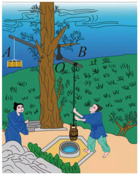

# Physics - 题目 1387

**ID**: 1b0783e2c15c43efbadb5f339c38dc7a
**年级**: Grade 9
**难度**: Medium
**题型**: Fill-in-the-blank

## 题目
如图所示，是《天工开物》中记载的我国传统提水工具“枯槔”，用绳子系住一根直的硬棒的O点作为支点，A端挂有重为40N的石块，B端挂有重为20N的空桶，OA长为1.2m，OB长为0.6m。​​​​​​​‌使用时，人向下拉绳放下空桶，此时桔槔为（选填“省力”“费力”或等臂）杠杆，生活中类似的杠杆还有（填写一种即可）；装满重为100N的水后向上拉绳缓慢将桶提起，向上拉绳提起装满水的桶时拉力为（硬棒质量忽略不计）。

## 解答

1. [1][2]人向下拉绳放下空桶时，动力臂小于阻力臂，根据杠杆平衡的条件可知，动力大于阻力，为费力杠杆，生活中船桨、钓鱼竿等都是费力杠杆。
2. [3]根据杠杆平衡的条件为
3. $G{{}_{A}}\times OA=F{{}_{B}}\times OB$
4. 带入数据为
5. $40{\rm{N}}\times 1.2{\rm{m}}=F{{}_{B}}\times 0.6{\rm{m}}$
6. 解得 $F{{}_{B}}=80{\rm{N}}$ ，向上拉绳提起装满水的桶时拉力为
7. $F=G{{}_{桶}}+G{{}_{水}}-F{{}_{B}}=100{\rm{N}}+20{\rm{N}}-80{\rm{N}}=40{\rm{N}}$

## 知识点

**中文**:
  - 杠杆平衡条件的应用
  - 杠杆的分类

**English**:
  - Application of Lever Equilibrium Conditions
  - Classification of Levers

---
