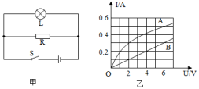

# Physics - 题目 2067

**ID**: 1c75832f056447cea8fff4141a6db752
**年级**: Grade 9
**难度**: Medium
**题型**: Fill-in-the-blank

## 题目
灯泡L与定值电阻R组成的电路如图甲，L和R的I-U图线分别为图乙中的 A、B，当S闭合时，L正常发光，此时电路的总功率为 4.8W。​​​​​​​‌则R的阻值为Ω，灯泡 L 的额定电压为V，若将它们串联在8V电源两端，接通电路后，灯泡L的实际功率为W。

## 解答

1. [1][2]分析图甲可知，闭合开关S，L和R并联接入电路，由并联电路的特点可知，此时L和R两端电压相等且等于电源电压，因为此时电路的总功率为4.8W，结合图乙可知，此时L和R两端电压为6V，流过R的电流为0.3A，故R的阻值
2. $R=\frac {U}{I{{}_{{\rm{R}}}}}=\frac {6{\rm{V}}}{0.3{\rm{A}}}{\rm{=}}20Ω$
3. 因为此时灯泡正常发光，所以灯泡 L的额定电压为6V。
4. [3]若将它们串联在8V电源两端，根据串联电路的电流、电压特点并结合乙图可知，此时电路中的电流为0.3A，灯泡两端电压为2V，则灯泡L的实际功率
5. $P{{}_{{\rm{L}}}}=U{{}_{{\rm{L}}}}I{{}_{{\rm{L}}}}{\rm{=}}2{\rm{V}}\times 0.3{\rm{A}}{\rm{=}}{\rm{0}}{\rm{.}}{\rm{6}}{\rm{W}}$

## 知识点

**中文**:
  - 实际电压与实际功率
  - 欧姆定律的应用
  - 电阻的伏安特性曲线
  - 电功率的计算及应用
  - 额定电压与额定功率

**English**:
  - Actual Voltage and Actual Power
  - Applications of Ohm's Law
  - I-V Characteristic Curve of Resistance
  - Calculation and Application of Electric Power
  - Rated Voltage and Rated Power

---
