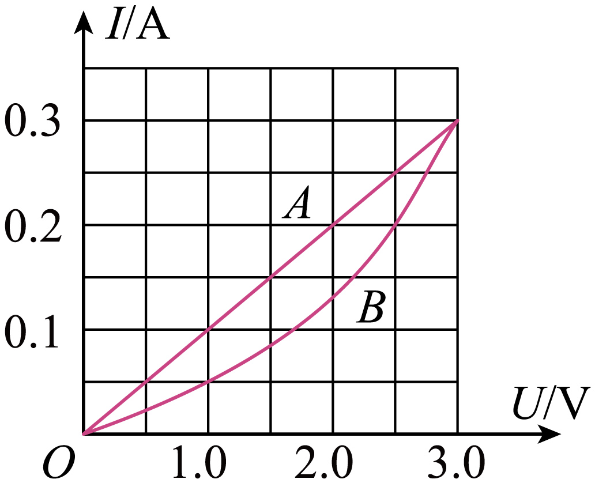

# Physics - 题目 620

**ID**: 207e1b6c1ef74060b148139f60461c72
**年级**: Grade 9
**难度**: Medium
**题型**: Fill-in-the-blank

## 题目
有两个电路元件A和B，流经各元件的电流I与其两端电压U的关系如图所示。​​​​​​​‌把A、B两元件串联起来接在某一电源两端，测得电路中电流为0.2A，则此时R_{A}∶R_{B}＝；若把A、B元件并联起来接在1V电源两端，电路中的总电流为A，此时R_{B}＝Ω。

## 解答

1. 由图象可知，两个导体串联接在某电源上，电路中的电流是0.2A时，U_{A}＝2V，U_{B}＝2.5V，两个元件的电阻之比为 $\frac {R{{}_{{\rm{A}}}}}{R{{}_{{\rm{B}}}}}=\frac {\frac {U{{}_{{\rm{A}}}}}{I}}{\frac {U{{}_{{\rm{B}}}}}{I}}=\frac {U{{}_{{\rm{A}}}}}{U{{}_{{\rm{B}}}}}=\frac {2{\rm{V}}}{2.5{\rm{V}}}=\frac {4}{5}$
2. 当将A和B并联后接在电压为1V的电源上时，由图可知，A的电流是0.1A，B的电流是0.05A，A和B并联在电路中，干路电流等于各支路的电流之和，干路电流 $I=I{{}_{{\rm{A}}}}+I{{}_{{\rm{B}}}}=0.1{\rm{A}}{\rm{+}}0.05{\rm{A}}{\rm{=}}0.15{\rm{A}}$ ，由欧姆定律得，R_{B}的电阻 $R{{}_{{\rm{B}}}}=\frac {U}{I{{}_{{\rm{B}}}}}=\frac {1{\rm{V}}}{0.05{\rm{A}}}=20{\rm{Ω}}$

## 知识点

**中文**:
  - 串联电路的电流规律
  - 并联电路的电流规律
  - 欧姆定律的应用

**English**:
  - Current Law in Series Circuits
  - Current Law in Parallel Circuits
  - Applications of Ohm's Law

---
