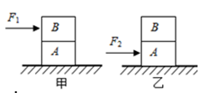

# Physics - 题目 2871

**ID**: 294b3f464b1a4a7a944b0fb504be416b
**年级**: Grade 9
**难度**: Medium
**题型**: Fill-in-the-blank

## 题目
如图甲所示，完全相同的A、B两正方体物块叠放在水平桌面上，用F_{1}＝50N的水平力作用在B物块上，AB一起做匀速直线运动，此时B物块所受的摩擦力为N；若将F_{1}换为大小为70N的水平力F_{2}按如图乙作用在A物块上，它们仍能一起向前运动，则地面对A物块的摩擦力为N，AB之间（有/无）摩擦力。​​​​​​​‌

## 解答

1. [1]甲图中推力在B上，以B为研究对象，B做匀速直线运动，所以其受到的推力F_{1}与摩擦力平衡，B物块所受的摩擦力为50N。
2. [2]甲图中AB做匀速直线运动，处于平衡状态，A受到B给A向右的50N摩擦力，受到地面给A向左的50N的摩擦力；图乙F_{1}换为大小为70N的水平力F_{2}作用在A物块上，此时接触的粗糙程度不变，压力也不变，因此摩擦力也不变，所以A所受的摩擦力仍为50N。
3. [3]图乙F_{1}换为大小为70N的水平力F_{2}作用在A物块上，A物块受到的摩擦力与推力不平衡，A做加速运动，B和A有相对运动的趋势，故AB间有摩擦力。

## 知识点

**中文**:
  - 二力及多力平衡的判断和应用

**English**:
  - Judgment and Application of Equilibrium of Forces

---
