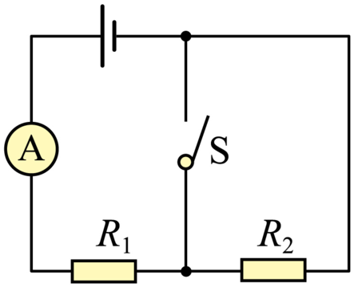

# Physics - 题目 2377

**ID**: 2dd1adfb26ed4e5596d1a8bb95fb7cd1
**年级**: Grade 9
**难度**: Medium
**题型**: Fill-in-the-blank

## 题目
如图所示，电源电压为 ${\rm{6}}{\rm{V}}$ ， $R{{}_{1}}=R{{}_{2}}=30{\rm{Ω}}$ ，当开关 ${\rm{S}}$ 断开时，电流表的示数是${\rm{A}}$ ；​​​​​​​‌当开关 ${\rm{S}}$ 闭合时，电流表的示数是${\rm{A}}$ ．

## 解答

1. [1]如图电路，当开关 ${\rm{S}}$ 断开时，两电阻串联，根据 $I=\frac {U}{R}$ 可得，电流表的示数： $I=\frac {U}{R}=\frac {6{\rm{V}}}{R{{}_{1}}+R{{}_{2}}}=\frac {6{\rm{V}}}{30{\rm{Ω}}+30{\rm{Ω}}}=0.1{\rm{A}}$ ；
2. [2] 当开关 ${\rm{S}}$ 闭合时，R_{2}被短路，电流表的示数为； $I^{′}=\frac {U}{R{{}_{1}}}=\frac {6{\rm{V}}}{30{\rm{Ω}}}=0.2{\rm{A}}$ ．

## 知识点

**中文**:
  - 欧姆定律的应用
  - 电路的动态分析

**English**:
  - Applications of Ohm's Law
  - Dynamic Circuit Analysis

---
