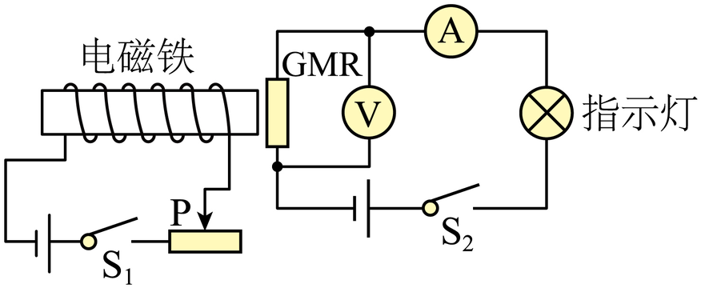

# Physics - 题目 1310

**ID**: 3365e1ab9feb4d6fb138b3fc0f5204cf
**年级**: Grade 9
**难度**: Medium
**题型**: Fill-in-the-blank

## 题目
如图是巨磁电阻（GMR）的特性原理示意图，巨磁电阻的阻值随所在磁场强度的增强而减小，闭合 ${\rm{S}}{{}_{1}}$ 、 ${\rm{S}}{{}_{2}}$ 并使滑片P向右滑动时，电磁铁的右端是极（选填“S”或“N”）；指示灯亮度将变；电压表示数变，电压表与电流表示数之比变（选填“大”或“小”）。​​​​​​​‌

## 解答

1. 闭合开关S_{1}后，电流从电磁铁右端流入，根据安培定则可知，电磁铁的左端为N极、右端为S极；由图可知，巨磁电阻与指示灯串联，电压表测量巨磁电阻的电压，电流表测量巨磁电阻和指示灯的电流，闭合S_{1}、S_{2}并使滑片P向右滑动，滑动变阻器连入电路的阻值变大，根据欧姆定律 $I=\frac {U}{R}$ 可知，通过电磁铁电流变小，磁性变弱，则巨磁电阻阻值增大，巨磁电阻所在电路的电流变小，电流表示数变小，指示灯亮度变暗；根据串联分压规律可知，巨磁电阻所分电压变大，电压表示数变大，电压表与电流表示数之比为巨磁电阻的阻值，由于巨磁电阻的阻值变大，则电压表与电流表示数之比变大。

## 知识点

**中文**:
  - 动态电路中电表示数的变化
  - 安培定则及其应用

**English**:
  - Changes in Meter Readings in Dynamic Circuits
  - Ampere's Rule and Applications

---
