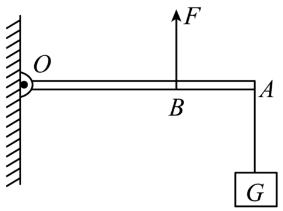

# Physics - 题目 2607

**ID**: 3fad05f71abd450cbcc5272ef7d12701
**年级**: Grade 9
**难度**: Medium
**题型**: Fill-in-the-blank

## 题目
如图所示，轻质杠杆OA可绕O点无摩擦转动，A点处挂一个重为20N的物体，B点处加一个竖直向上的力F，杠杆在水平位置平衡，且OB：AB=2：1.则F=N，它是杠杆。​​​​​​​‌

## 解答

1. [1]根据杠杆平衡条件可知
2. $F\times OB=G\times OA$
3. 则
4. $F=G\times \frac {OA}{OB}=G\times \frac {OB{\rm{+}}AB}{OB}=G\times \frac {OB{\rm{+}}{\rm{0}}{\rm{.}}{\rm{5}}OB}{OB}=1.5G=1.5\times 20{\rm{N}}=30{\rm{N}}$
5. [2]由于动力臂小于阻力臂，故它是费力杠杆。

## 知识点

**中文**:
  - 杠杆平衡条件的应用
  - 杠杆的分类

**English**:
  - Application of Lever Equilibrium Conditions
  - Classification of Levers

---
