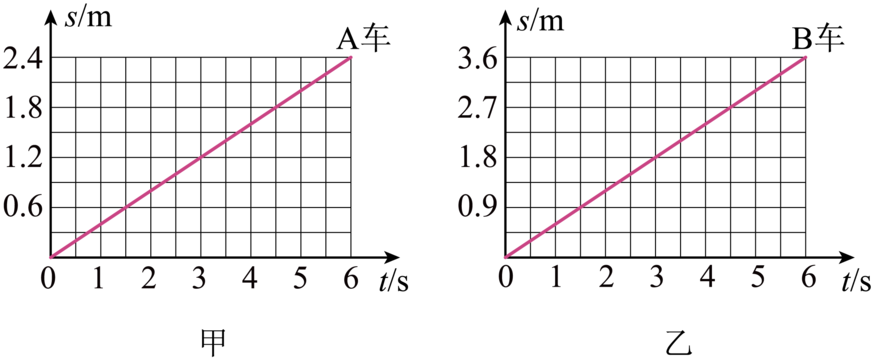

# Physics - 题目 2488

**ID**: 478b0533d50742ad862c31ce9594a1e8
**年级**: Grade 9
**难度**: Medium
**题型**: Fill-in-the-blank

## 题目
两小车A、B分别在同一直线上的C、D两点（C、D间距为20m），同时相向做直线运动，它们的s—t图像分别如图甲、乙所示。​​​​​​​‌若A、B的速度分别为v_{A}、v_{B}，则：（1）A车做的直线运动（选填“匀速”或“变速”），v_{A}v_{B}（选填“>”、“=”或“<”）；（2）经过6s，两车相距m，A车再运动s到达D点。

## 解答

1. （1）[1]图甲中，A车的路程和时间成正比，故A做匀速直线运动。
2. [2]A的速度
3. $v{{}_{{\rm{A}}}}=\frac {s{{}_{{\rm{A}}}}}{t{{}_{{\rm{A}}}}}=\frac {{\rm{2}}{\rm{.}}{\rm{4}}{\rm{m}}}{{\rm{6}}{\rm{s}}}=0.4{\rm{m}}{\rm{/}}{\rm{s}}$
4. B的速度
5. $v{{}_{{\rm{B}}}}=\frac {s{{}_{{\rm{B}}}}}{t{{}_{{\rm{B}}}}}=\frac {{\rm{3}}{\rm{.}}{\rm{6}}{\rm{m}}}{{\rm{6}}{\rm{s}}}=0.6{\rm{m}}{\rm{/}}{\rm{s}}$
6. 所以v_{A}<v_{B}。
7. （2）[3]由图甲知，经过6s，A走过的路程是s_{A}=2.4m，由图乙知，经过6s，B走过的路程为s_{B}=3.6m，两车相距
8. Δs-s_{B}-s_{A}=20m-3.6m-2.4m=14m
9. [4]A到D的距离
10. s_{AD}=20m-2.4m=17.6m
11. 到达D的时间
12. $t{{}_{{\rm{A}}{\rm{D}}}}=\frac {s{{}_{{\rm{A}}{\rm{D}}}}}{v{{}_{{\rm{A}}}}}=\frac {{\rm{1}}{\rm{7}}{\rm{.}}{\rm{6}}{\rm{m}}}{{\rm{0}}{\rm{.}}{\rm{4}}{\rm{m}}{\rm{/}}{\rm{s}}}=44{\rm{s}}$

## 知识点

**中文**:
  - 速度的图像问题
  - 速度的综合计算

**English**:
  - Velocity-Time Graphs
  - Comprehensive Velocity Calculations

---
