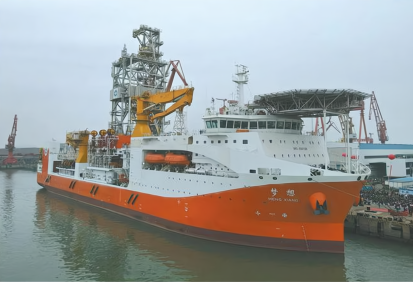

# Physics - 题目 203

**ID**: 4f163351830a4db18ede8244ff6cf9f9
**年级**: Grade 9
**难度**: Medium
**题型**: Fill-in-the-blank

## 题目
2023年12月27日，中国首超深水大洋钻探船—“梦想”号顺利完成首次试航。​​​​​​​‌“梦想”号排水量约为33000t，可抵御16级台风海况，具备海域11000m的钻探能力，标志着我国深海探测能力建设和海洋技术装各研发迈出关键一步。（1）试航时，“梦想”号受水的浮力约为N　（g取10N/kg）（2）大洋钻探船最主要的功能是钻井取芯，把海底的岩芯取上来，岩芯加速上升过程中，缆绳对岩芯的力（填“大于”“等于”或“小于”）岩芯对缆绳的力；（3）“梦想”号装有深度声呐并搭载高清摄像系统。声呐利用（选填“超声波”“次声波”或“电磁波”）探测海洋深度；（5）台风天气，钻探船可适当（选填“提高”或“降低”）重心来抵御台风。

## 解答

1. （1）试航时，“梦想”号受水的浮力约为 $F{{}_{浮}}=G{{}_{排}}=m{{}_{排}}g=33000\times 10{^{3}}{\rm{k}}{\rm{g}}\times 10{\rm{N}}{\rm{/}}{\rm{k}}{\rm{g}}=3.3\times 10{^{8}}{\rm{N}}$ 。
2. （2）缆绳对岩芯的力和岩芯对缆绳的力是一对相互作用力，其大小相等。
3. （3）超声波遇到障碍物很容易反射，“梦想”号装有深度声呐。声呐利用超声波的反射探测海洋深度。
4. （4）物体重心越低越稳定，故台风天气，钻探船可适当降低重心来抵御台风。

## 知识点

**中文**:
  - 力的作用是相互的
  - 超声波的应用
  - 重心
  - 阿基米德原理的应用

**English**:
  - Interaction of Forces
  - Applications of Ultrasound
  - Center of Gravity
  - Applications of Archimedes' Principle

---
