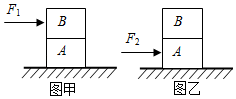

# Physics - 题目 2574

**ID**: 51c83fcf15aa45d887740327872a7c02
**年级**: Grade 9
**难度**: Medium
**题型**: Fill-in-the-blank

## 题目
如图甲所示，完全相同的A、B两物块重100N，把它们叠放在水平桌面上，用F_{1}＝50N的水平力作用在B物块上，A、B一起做匀速直线运动，此时B物块所受的摩擦力为N；若将它们叠放在水平地面上，用F_{2}＝50N的水平力按如图乙所示作用在A物块上，它们一起做匀速直线运动，则B物块所受的摩擦力为。​​​​​​​‌

## 解答

1. [1]甲图中，对B物块进行受力分析可知，在水平方向上B受到水平向右的推力F_{1}，A对B水平向左的摩擦力，在这两个力的作用下B做匀速直线运动，故B物块所受的摩擦力等于推力F_{1}，大小为50N。
2. [2]若将它们叠放在水平地面上，用F_{2}＝50N的水平力按如图乙所示作用在A物块上，它们一起做匀速直线运动，则B受到的合力为0，B与A之间没有发生相对滑动的趋势，所以B与A之间没有摩擦力，即摩擦力为0N。

## 知识点

**中文**:
  - 二力及多力平衡的判断和应用

**English**:
  - Judgment and Application of Equilibrium of Forces

---
