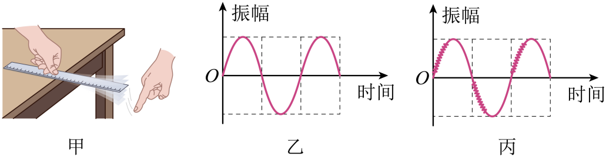

# Physics - 题目 1187

**ID**: 57288ab0ccac40fea833ad5761896bb5
**年级**: Grade 9
**难度**: Medium
**题型**: Fill-in-the-blank

## 题目
在物理实验活动中，创新实验小组的同学利用日常学习中使用的塑料尺进行了探究活动。​​​​​​​‌（1）如图甲所示，用手掌将塑料尺的一端压在桌面上，用手拨动塑料尺伸出桌面的一端进行相关探究，本实验所研究的声源是（填“塑料尺”或“桌面”）；（2）先用较小的力轻拨塑料尺，再用较大的力重拨塑料尺。分析比较两次实验现象可探究声音的响度与声源振动的有关；（3）拨动塑料尺的力不变，使塑料尺伸出桌面的长度由短变长，用仪器测得两次实验声音分别为1.3×10^{2}和1.2×10^{2}，两个数据的单位是（填单位符号）；可见随着塑料尺伸出桌面的长度变长，观察到直尺的振动（填“变快”“变慢”或“不变”），发出声音的变低；（4）拨塑料尺的力不变，塑料尺伸出桌面的长度不变，在塑料尺右端开小孔，开孔前后两次发声的波形图象如图乙、丙所示。可见结构的不同，会导致发出声音的改变。

## 解答

1. （1）拨动塑料尺，塑料尺振动发声，本实验所研究的声源是塑料尺。
2. （2）先用较小的力轻拨塑料尺，塑料尺振动幅度小，发出声音的响度小，用较大的力重拨塑料尺，塑料尺振动幅度大，发出声音的响度大，可探究声音的响度与声源振动的振幅有关。
3. （3）拨动塑料尺的力不变，即保持塑料尺的振动幅度不变，塑料尺伸出越长，振动变慢，发出声音的音调变低，频率的单位是Hz，两次实验声音分别为1.3×10^{2}和1.2×10^{2}，两个数据的单位是Hz。
4. （4）开孔前后物体结构不同，物体振动发出的声音的音色不同。

## 知识点

**中文**:
  - 响度的探究实验
  - 声音的产生和声源
  - 音调的探究实验

**English**:
  - Experiment: Investigating Loudness
  - Sound Production and Sound Sources
  - Experiment: Investigating Pitch

---
