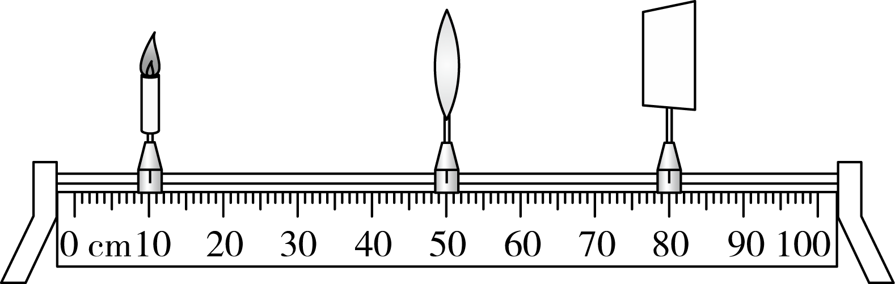

# Physics - 题目 410

**ID**: 729c8dc159564212be9ad2453b2de260
**年级**: Grade 9
**难度**: Medium
**题型**: Fill-in-the-blank

## 题目
实验室利用光具座研究凸透镜成像的规律，当三个元件移动到图示位置时，光屏上出现了清晰的像，从图中读出物距为cm，并推算出焦距为（选填“f<15cm”、“15cm<f<20cm”、“f>30cm”）。​​​​​​​‌

## 解答

1. 由图可知，物距 $u=50.0{\rm{c}}{\rm{m}}-10.0{\rm{c}}{\rm{m}}=40.0{\rm{c}}{\rm{m}}$
2. 由图可知，像距为 $v=80.0{\rm{c}}{\rm{m}}-50.0{\rm{c}}{\rm{m}}=30.0{\rm{c}}{\rm{m}}$ ，物距大于像距，因此所成的像是倒立缩小的实像，则 $u>2f$ ， $2f>v>f$ ，即 $40{\rm{c}}{\rm{m}}>2f$ ， $2f>30{\rm{c}}{\rm{m}}>f$ ，解得 $15{\rm{c}}{\rm{m}}<f<{\rm{2}}{\rm{0}}{\rm{c}}{\rm{m}}$

## 知识点

**中文**:
  - 凸透镜成像规律的应用

**English**:
  - Applications of Convex Lens Imaging

---
