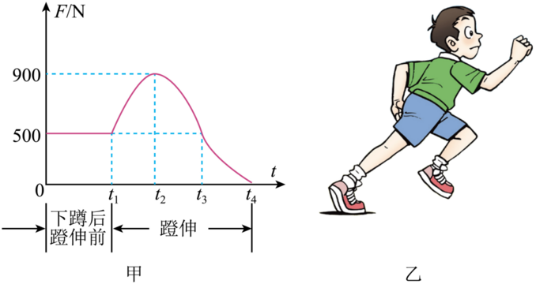

# Physics - 题目 1800

**ID**: 74d054f174954b8e97dd9c98f60d7a5c
**年级**: Grade 9
**难度**: Medium
**题型**: Fill-in-the-blank

## 题目
运动会上，小刚报名的立定跳高和跑步。​​​​​​​‌立定跳高可分解为下蹲、蹬伸和腾空三个过程。图甲为小刚下蹲后在蹬伸过程中所受地面支持力F随时间t变化的关系。据图可知，他在t_{1}～t_{2}之间做（减速/加速/匀速）运动。图乙是小刚跑步的照片，当他后脚用力蹬地时，后脚鞋底受到地面摩擦力的方向是向（前/后）的，鞋底有花纹，是为了摩擦。

## 解答

1. 运动员下蹲后、蹬伸前处于静止状态（图中0~t_{1}这段时间），其受力平衡，重力和支持力平衡，二力的大小相等，则由图像可知运动员的重力为G＝F＝500N，运动员受到地面的支持力F方向向上，运动员的重力G方向向下；由图像可知：t_{1}~t_{2}内，F＞G，运动员所受合力向上，运动员向上加速运动。蹬地时脚相对于地面有向后滑动的趋势，地面给脚一个向前的摩擦力，因此后脚受到摩擦力方向是水平向前的。鞋底有花纹，是在压力一定时，通过增大接触面的粗糙程度来增大摩擦力。

## 知识点

**中文**:
  - 力与运动的关系
  - 静摩擦力的方向
  - 增大或减小摩擦的方法

**English**:
  - Relationship between Force and Motion
  - Direction of Static Friction
  - Methods to Increase or Decrease Friction

---
