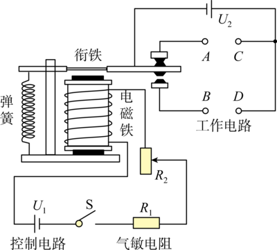

# Physics - 题目 1359

**ID**: 756e0e51c62c4ad2a0df631d6153930c
**年级**: Grade 9
**难度**: Medium
**题型**: Fill-in-the-blank

## 题目
如图所示是汽车尾气中CO排放量的检测电路，当CO浓度高于某一设定值时，电铃发声报警，图中的气敏电阻 $R{{}_{1}}$ 的阻值随CO浓度的增大而减小，则电铃应接在之间；电源用久后，电压 $U{{}_{1}}$ 会减小，则报警的CO最小浓度比设定值（选填“高”或“低”），为使该检测电路在CO浓度更低时报警，可将 $R{{}_{2}}$ 的滑片适当向（选填“上”或“下”）移动。​​​​​​​‌

## 解答

1. 因气敏电阻R_{1}的阻值随CO浓度的增大而减小，所以，CO浓度升高时气敏电阻R_{1}的阻值减小，控制电路的总电阻减小，由 $I=\frac {U}{R}$ 可知，控制电路的电流增大，电磁铁的磁性增强，当CO浓度高于某一设定值时，衔铁被吸下，电铃发声报警，据此可知电铃应接在B、D之间。
2. 当CO浓度高于某一设定值时，电铃发声报警，此时控制电路的电流一定，电源用久后，电压U_{1}会减小，由 $R{{}_{总}}=\frac {U{{}_{1}}}{I}$ 可知，电铃发声报警时控制电路的总电阻减小，气敏电阻R_{1}的阻值减小，CO浓度增大， 则报警的CO最小浓度比设定值高。
3. 当CO浓度高于某一设定值时，电铃发声报警，此时控制电路的电流一定，由 $R{{}_{总}}=\frac {U{{}_{1}}}{I}$ 可知，电铃发声报警时控制电路的总电阻一定，因CO浓度越小时气敏电阻R_{1}的阻值越大，所以，要使该检测电路在CO浓度更低时报警，应将R_{2}的滑片向上移，减小变阻器R_{2}接入电路中的电阻，即将R_{2}的滑片适当下移。

## 知识点

**中文**:
  - 欧姆定律的应用
  - 电路的动态分析
  - 电磁继电器的常见应用

**English**:
  - Applications of Ohm's Law
  - Dynamic Circuit Analysis
  - Common Applications of Electromagnetic Relays

---
