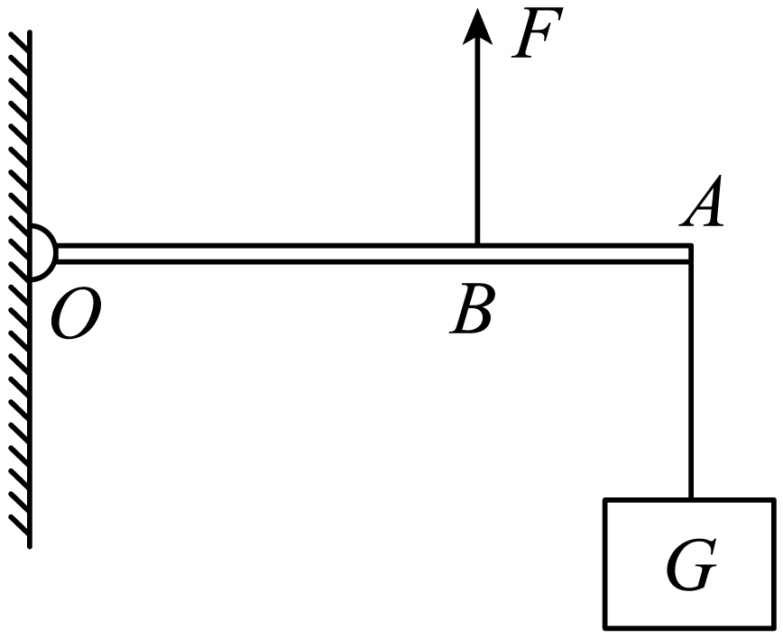

# Physics - 题目 2906

**ID**: 8116fbdd286e4fea9aa9c4fd2e3109c3
**年级**: Grade 9
**难度**: Medium
**题型**: Fill-in-the-blank

## 题目
如图所示，轻质杠杆OA可绕O点转动，OA=0.3米，OB=0.2米。​​​​​​​‌A点处挂一个质量为2千克的物体G，B点处加一个竖直向上的力F，杠杆在水平位置平衡，则物体G的重力大小为牛，力F大小为牛。

## 解答

1. [1][2]物体的重力大小为
2. G=mg=2kg×10N/kg=20N
3. 杠杆A点受到的拉力等于物体的重力，根据杠杆平衡条件可得
4. F×OB=G×OA
5. 则F的大小为
6. $F=\frac {G\times OA}{OB}=\frac {20{\rm{N}}\times 0.3{\rm{m}}}{0.2{\rm{m}}}=30{\rm{N}}$

## 知识点

**中文**:
  - 杠杆平衡条件的应用
  - 重力公式的应用

**English**:
  - Application of Lever Equilibrium Conditions
  - Application of Gravity Formula

---
