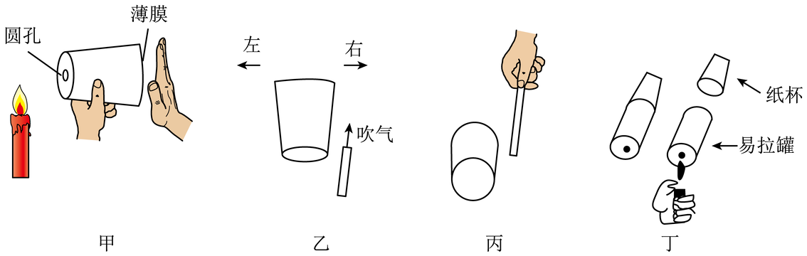

# Physics - 题目 2282

**ID**: 84b93b29f8a045399848e3ff8f4f69ac
**年级**: Grade 9
**难度**: Medium
**题型**: Fill-in-the-blank

## 题目
小鹏利用身边的纸杯做了很多有趣的小实验。​​​​​​​‌（1）图甲中，纸杯底部有一圆孔，用薄膜蒙住杯口，拍打薄膜发出声音，烛焰晃动，说明声音具有；（2）图乙中，在纸杯旁用吸管吹气，纸杯向（选填“左”或“右”）滚动，这是因为气体流速越大，压强越；（3）图丙中，用与头发摩擦过的塑料吸管吸引纸杯，这是因为带电体可以；（4）图丁中，将一个空易拉罐的底部钻一个小孔，往易拉罐里喷少量酒精，然后将一个空的纸杯迅速套上，将易拉罐底部的小孔靠近点燃的打火机。纸杯就会飞出去。纸杯飞出去的过程与四冲程汽油机冲程能量转化相同。

## 解答

1. （1）拍打薄膜，薄膜振动发出声音，空气把振动传递到烛焰，烛焰晃动，说明声音具有能量。
2. （2）在纸杯旁用吸管吹气，纸杯右边的气体流速大，压强小，左侧空气流速慢，压强大，故纸杯将向右边滚动。
3. （3）与头发摩擦过的塑料吸管带了电荷，带电的塑料管靠近纸杯一侧，纸杯被吸引，这是因为带电体能吸引轻小物体。
4. （4）用打火机点燃纸杯内的酒精，酒精燃烧产生的气体对套上去的纸杯做功，纸杯飞出去的过程，燃气的内能转化为纸杯的机械能，相当于内燃机的做功冲程。

## 知识点

**中文**:
  - 内燃机的四个冲程
  - 声与能量
  - 流体压强与流速的关系
  - 物体带电现象及特点

**English**:
  - Four Strokes of Internal Combustion Engines
  - Sound and Energy
  - Relationship between Fluid Pressure and Flow Speed
  - Phenomena and Characteristics of Charged Objects

---
