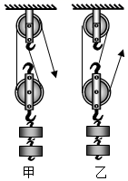

# Physics - 题目 2116

**ID**: 8722b298efc6489b911350d8be50cca3
**年级**: Grade 9
**难度**: Medium
**题型**: Fill-in-the-blank

## 题目
用四只完全相同的滑轮和两根相同的绳子组成如图所示的甲、乙两个滑轮组，分别将两个相同的钩码提升10cm，若不计绳子与滑轮的摩擦，装置更省力（选填“甲”或“乙”），甲装置的机械效率乙装置的机械效率（选填“高于”、“低于”或“等于”）。​​​​​​​‌

## 解答

1. [1]不计摩擦，拉力F= $\frac {1}{n}$ (G_{物}+G_{轮})
2. n_{甲}=2，n_{乙}=3
3. 绳子受的拉力
4. F_{甲}= $\frac {1}{2}$ (G_{物}+G_{轮})，F_{乙}= $\frac {1}{3}$ (G_{物}+G_{轮})
5. F_{甲}＞F_{乙}
6. 乙更省力。
7. [2]动滑轮重相同，提升的物体重和高度相同
8. W_{额}=G_{轮}h，W_{有用}=G_{物}h
9. 利用滑轮组做的有用功相同、额外功相同，总功相同，滑轮组的机械效率相同，即
10. η_{甲}=η_{乙}

## 知识点

**中文**:
  - 机械效率的大小比较
  - 滑轮组及其工作特点

**English**:
  - Comparing Mechanical Efficiency
  - Pulley Systems and Operating Characteristics

---
