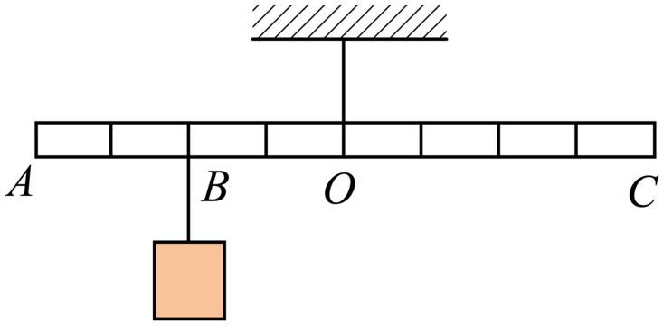

# Physics - 题目 2100

**ID**: 87241ed6408a4b9c8e3cf99fcafdebe5
**年级**: Grade 9
**难度**: Medium
**题型**: Fill-in-the-blank

## 题目
如图所示，AC为刻度间隔相等的轻质杠杆，B处挂4N的物体。​​​​​​​‌为使杠杆在水平位置平衡，则在C端施加的最小力是N，方向是。若在A端施加一个拉力F，刚好使杠杆在水平位置平衡时为等臂杠杆，请回答是否存在拉力F？如存在，准确写出拉力F的方向；如不存在，试说明理由：、。

## 解答

1. 由图可知，B处挂4N的物体，物体对杠杆的拉力方向竖直向下，为了使杠杆在水平位置平衡，在C端施加的力的方向应竖直向下，则支点到F_{B}的力臂有2小格，支点到F_{C}的力臂有4小格，由杠杆平衡条件可知
2. $F{{}_{{\rm{B}}}}\times L{{}_{{\rm{B}}}}=F{{}_{{\rm{C}}}}\times L{{}_{{\rm{C}}}}$
3. 即
4. $4{\rm{N}}\times 2=F{{}_{{\rm{C}}}}\times 4$
5. 解得
6. $F{{}_{{\rm{C}}}}=2{\rm{N}}$ 在A端施加一个拉力F，刚好使杠杆在水平位置平衡时为等臂杠杆，则动力臂等于阻力臂，由图可知，支点到F_{B}的力臂有2小格，OA的距离有4小格，由数学知识，在直角三角形中，30°角所对的直角边为斜边的 $\frac{1}{2}$ ，所以拉力F与杠杆成30°角斜向上时，拉力F的力臂为OA的 $\frac{1}{2}$ ，有2小格，此时刚好使杠杆在水平位置平衡时为等臂杠杆。

## 知识点

**中文**:
  - 杠杆中最小力的问题
  - 杠杆平衡条件的应用

**English**:
  - Minimum Force Problems in Levers
  - Application of Lever Equilibrium Conditions

---
