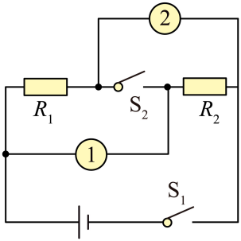

# Physics - 题目 1465

**ID**: 90541f7da2814edeb32657c1981ee7d4
**年级**: Grade 9
**难度**: Medium
**题型**: Fill-in-the-blank

## 题目
如图，当1、2都为电压表时，闭合开关S_{1}、S_{2}，两表示数比为2:3，则R_{1}和R_{2}的比值为，当1、2都是电流表时，只闭合开关S_{1}，R_{1}和R_{2}消耗功率的比值为。​​​​​​​‌

## 解答

1. 当1、2都为电压表时，闭合开关S_{1}、S_{2}，两电阻串联，电压表V_{1}测R_{1}两端的电压，电压表V_{2}测R_{2}两端的电压，因串联电路中各处的电流相等，所以，由 $I=\frac {U}{R}$ I可得，R_{1}和R_{2}的阻值之比 $\frac {R{{}_{1}}}{R{{}_{2}}}=\frac {\frac {U{{}_{1}}}{I}}{\frac {U{{}_{2}}}{I}}=\frac {U{{}_{1}}}{U{{}_{2}}}=\frac {U{{}_{{\rm{V}}{{}_{1}}}}}{U{{}_{{\rm{V}}{{}_{2}}}}}=\frac {2}{3}$ ，当1、2都是电流表时，只闭合开关S_{1}，两电阻并联，电流表A_{1}测R_{2}支路的电流，电流表A_{2}测R_{1}支路的电流，因并联电路中各支路两端的电压相等，由 $P=UI=\frac {U{^{2}}}{R}$ 可知，R_{1}和R_{2}消耗的功率之比 $\frac {P{{}_{1}}}{P{{}_{2}}}=\frac {\frac {U{^{2}}}{R{{}_{1}}}}{\frac {U{^{2}}}{R{{}_{2}}}}=\frac {R{{}_{2}}}{R{{}_{1}}}=\frac {3}{2}$ 。

## 知识点

**中文**:
  - 欧姆定律的应用
  - 电路的动态分析
  - 电功率的计算及应用

**English**:
  - Applications of Ohm's Law
  - Dynamic Circuit Analysis
  - Calculation and Application of Electric Power

---
