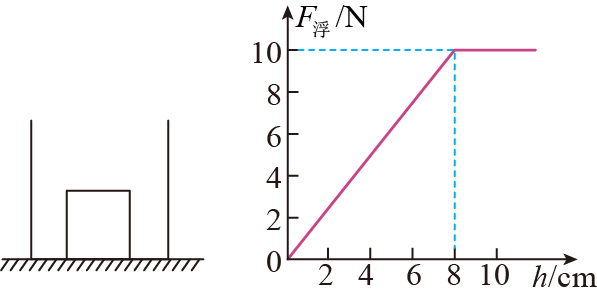

# Physics - 题目 1123

**ID**: 99f3d3ce486e442e8e64d5729d107808
**年级**: Grade 9
**难度**: Medium
**题型**: Fill-in-the-blank

## 题目
如图所示，一个边长为10cm的实心正方体物块置于足够深的圆柱形容器底部。​​​​​​​‌现逐渐向容器内倒入某种液体，物块受到的浮力F_{浮}与容器内液体的深度h的关系图象如图所示，实心正方体物块的质量为kg，容器中液体的密度为kg/m^{3}。（g取10N/kg）

## 解答

1. [1]由右图可知，当液体深度为8cm时正方体所受到的浮力不再增加，由F_{浮}=ρ_{液}gV_{排}可知此时正方体排开的液体的体积不变，而正方体边长为10cm，可知此时正方体漂浮在液体上，受向下的重力和向上的浮力处于平衡状态，由二力平衡可知此时浮力等于重力为10N，即
2. F_{浮}=G=10N
3. 由G=mg可知正方体的质量为
4. $m=\frac {G}{g}=\frac {10{\rm{N}}}{1{\rm{0}}{\rm{N}}{\rm{/}}{\rm{k}}{\rm{g}}}=1{\rm{k}}{\rm{g}}$
5. [2]正方体漂浮时浸入液体中的深度为h=8cm，可知浸入液体中的体积为
6. V_{排}=l^{2}h=(10cm)^{2}×8cm=0.8×10^{-3}m^{3}
7. 由F_{浮}=ρ_{液}gV_{排}可知液体的密度为
8. $ρ{{}_{液}}=\frac {F{{}_{浮}}}{gV{{}_{排}}}=\frac {1{\rm{0}}{\rm{N}}}{10{\rm{N}}{\rm{/}}{\rm{k}}{\rm{g}}\times 0.8\times 10{^{{\rm{-}}{\rm{3}}}}{\rm{m}}{^{3}}}=1.25\times 10{^{{\rm{3}}}}{\rm{k}}{\rm{g}}{\rm{/}}{\rm{m}}{^{{\rm{3}}}}$

## 知识点

**中文**:
  - 重力公式的应用
  - 阿基米德原理的应用

**English**:
  - Application of Gravity Formula
  - Applications of Archimedes' Principle

---
