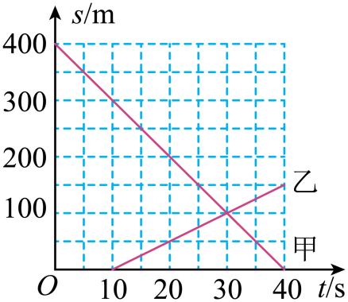

# Physics - 题目 976

**ID**: 9c749e7e4eca4bf7bb59a066e49fa19c
**年级**: Grade 9
**难度**: Medium
**题型**: Fill-in-the-blank

## 题目
甲、乙两物体在同一平直的路面上运动，且维持各自运动状态不变，它们的 $s{\rm{-}}t$ 部分图像如图所示，经过s，甲、乙相距300m。​​​​​​​‌

## 解答

1. 由题图可知，甲物体的运动速度为 $v{{}_{甲}}{\rm{=}}\frac {s{{}_{甲}}}{t{{}_{甲}}}{\rm{=}}\frac {{\rm{4}}{\rm{0}}{\rm{0}}{\rm{m}}}{{\rm{4}}{\rm{0}}{\rm{s}}}{\rm{=}}{\rm{1}}{\rm{0}}{\rm{m}}{\rm{/}}{\rm{s}}$ ，乙物体的运动速度为
2. $v{{}_{乙}}{\rm{=}}\frac {s{{}_{乙}}}{t{{}_{乙}}}{\rm{=}}\frac {{\rm{1}}{\rm{5}}{\rm{0}}{\rm{m}}}{{\rm{4}}{\rm{0}}{\rm{s}}{\rm{-}}10{\rm{s}}}{\rm{=}}{\rm{5}}{\rm{m}}{\rm{/}}{\rm{s}}$ ，①结合图像可知，在10s时，甲物体在300m处，乙物体在0m处，此时甲、乙物体相距300m；②在30s时，甲乙两物体相遇，相距0m；在t秒后，甲、乙物体相距300m，此时应满足 $v{{}_{甲}}t+v{{}_{乙}}t{\rm{=}}300{\rm{m}}$ ，即 $10{\rm{m}}{\rm{/}}{\rm{s}}\times t+5{\rm{m}}{\rm{/}}{\rm{s}}\times t{\rm{=}}300{\rm{m}}$ ，解得t=20s，所以再经过30s+20s=50s后，甲乙两物体相距300m。

## 知识点

**中文**:
  - 速度的图像问题
  - 速度的综合计算

**English**:
  - Velocity-Time Graphs
  - Comprehensive Velocity Calculations

---
