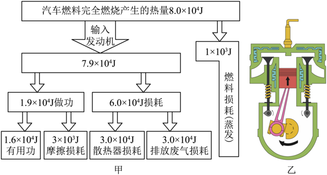

# Physics - 题目 2329

**ID**: 9f44bd1f422f4644a6eb9c696f260d52
**年级**: Grade 9
**难度**: Medium
**题型**: Fill-in-the-blank

## 题目
某物理小组的同学在社会实践活动中，通过实际调查和网上查询，绘制了一辆某种型号混合动力汽车的燃油发动机在额定功率下行驶时单位时间的能量流向图，如图甲所示，请回答下列问题。​​​​​​​‌（1）已知该型号汽车的燃油发动机是单缸四冲程汽油机。汽油机（选填“是”或“不是”）热机，热机是利用内能做功的机械。如图乙所示是单缸四冲程汽油机工作时某个冲程的示意图，是冲程，该冲程中的主要能量转化过程是（填写“××能转化为××能”）。（2）分析图甲可知，该型号汽车的燃油发动机的热机效率为%。请结合能量流向图写出一条提高该台燃油发动机热机效率的方法：。（3）随着科技的发展，人们对燃油发动机不断地进行改进，燃油发动机的热机效率（选填“能”或“不能”）达到100%。（4）新能源汽车能量回收系统主要是回收车辆在制动或惯性减速（物体靠惯性前进的同时，因受阻而慢慢减速）时释放出的多余能量并通过发电机将其转化为电能，再转存至蓄电池中用于汽车的动力行驶。小组中的一些同学认为，若该型号混合动力汽车使用电动机行驶，同时汽车的能量回收系统也在源源不断地回收释放出的多余能量，这样这台汽车就能一直行驶下去，是一台永动机。这些同学的想法是（选填“正确的”或“错误的”）。

## 解答

1. （1）汽油机通过燃烧燃料将内能转化为机械能，符合热机的定义，因此是热机。
2. 图乙中，进气门和排气门均关闭，活塞向上运动，压缩气缸内气体，此为压缩冲程。
3. 压缩冲程中，活塞的机械能转化为气缸内气体的内能。
4. （2）热机效率为有用功与燃料完全燃烧放出的热量之比，代入数据可得 $η=\frac {W{{}_{有}}}{Q{{}_{放}}}\times 100\%=\frac {1.6\times 10{^{4}}{\rm{J}}}{8\times 10{^{4}}{\rm{J}}}\times 100\%=20\%$
5. 从能量流向图可知，能量损耗包括摩擦损耗、散热损耗等，因此可通过加润滑油减少摩擦损耗，或改进散热装置减少散热损耗来提高效率。
6. （3）热机工作时必然存在能量损耗，如散热、克服摩擦做功等，无法将燃料完全燃烧放出的热量全部转化为有用功，因此热机效率不能达到100%。
7. （4）永动机违背能量守恒定律，汽车能量回收系统回收的能量小于行驶过程中消耗的能量，且回收过程中也存在能量损耗，无法实现能量的无限循环利用，因此这些同学的想法是错误的。

## 知识点

**中文**:
  - 内燃机的四个冲程
  - 有关热机效率的计算
  - 提高热机效率的方法

**English**:
  - Four Strokes of Internal Combustion Engines
  - Calculations of Heat Engine Efficiency
  - Methods to Improve Heat Engine Efficiency

---
