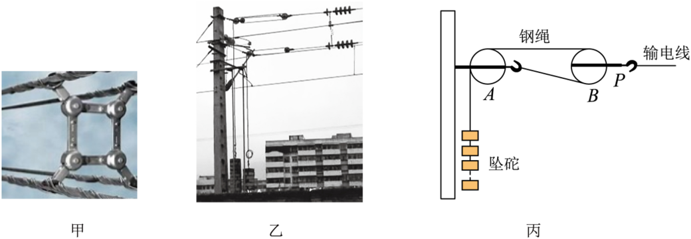

# Physics - 题目 1041

**ID**: a3240589288a4be7a83be14a0f786a2b
**年级**: Grade 9
**难度**: Medium
**题型**: Fill-in-the-blank

## 题目
中国高铁运营里程突破4万公里，稳居世界第一，关于高速铁路输电线的相关问题如下：（1）电能属于（选填“一次”或“二次”）能源，输电线上的能量损耗主要是由于电流的效应引起的。​​​​​​​‌如图甲是四根高压输电线上的一个装置，利用这个装置将四根导线并联起来，相当于增大了导线的，从而减小了导线的，以达到减少输电线上电能损失的目的；（2）如图乙，绷直的输电线采用坠砣牵引确保列车电极与输电线的良好接触，图丙为输电线的牵引装置工作原理图，不计滑轮和钢绳自重、摩擦。①该装置A滑轮是滑轮（选填“定”或“动”）；②要使输电线P端受到的拉力大小为 $1\times 10{^{4}}{\rm{N}}$ ，则坠砣的总重力为N；③若某段时间内坠砣串下降了30cm，则输电线P端向左移动了cm。

## 解答

1. （1） 电能不能从自然界直接获取，属于二次能源。
2. 输电线上的能量损耗主要是由于电流的热效应引起的。
3. 导体的横截面积越大，电阻越小。如图甲是四根高压输电线上的一个装置，利用这个装置将四根导线并联起来，相当于增大了导线的横截面积，从而减小了导线的电阻，以达到减少输电线上电能损失的目的。
4. （2） 由图知道，滑轮A固定不动，为定滑轮，可以改变力的方向。 有效绳子段数 $n=2$ ，所以坠砣的总重力为 $G=\frac {1}{2}F=\frac {1}{2}\times 1\times 10{^{4}}{\rm{N}}=5000{\rm{N}}$ ，输电线P端向左移动距离为 $l=\frac {1}{2}s=\frac {1}{2}\times 30{\rm{c}}{\rm{m}}=15{\rm{c}}{\rm{m}}$ 。

## 知识点

**中文**:
  - 影响电阻大小的因素
  - 滑轮组及其工作特点
  - 滑轮组绳子拉力的计算
  - 能源的分类
  - 节约用电

**English**:
  - Factors Affecting Resistance
  - Pulley Systems and Operating Characteristics
  - Calculating Rope Tension in Pulley Systems
  - Classification of Energy Sources
  - Saving Electricity

---
