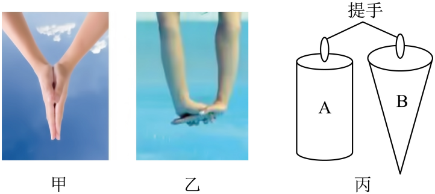

# Physics - 题目 1981

**ID**: ba904e63a83f4016ab6a7b1a021f4ca9
**年级**: Grade 9
**难度**: Medium
**题型**: Fill-in-the-blank

## 题目
小李同学观看跳水比赛，听主持人说平掌姿势（如图甲）入水溅起的水花高度较小；他则认为用双手合十的姿势（如图乙）入水溅起的水花高度可能更小。​​​​​​​‌查阅资料得知，物体从高处下落至水面时溅起的水花高度可能与物体的质量、形状、入水速度以及入水方向有关。为探究哪种入水姿势更合理（即水溅起的高度与物体形状的关系），他用橡皮泥制作了如图丙所示的A、B两个物体模拟平掌姿势与双手合十姿势，制作过程中应控制两物体的相同。提起A物体从水面上方某一位置自由释放，记录下水花溅起的最大高度 $h{{}_{1}}$ ，接下来的操作是：，然后。若，则说明平掌入水姿势更合理。

## 解答

1. 物体从高处下落至水面时溅起的水花高度可能与物体的质量、形状、入水速度以及入水方向有关，研究与形状关系必须控制入水方向不变、质量、速度（动能）制作过程中应控制两物体的质量必须相同。
2. 提起A物体从水面上方某一位置自由释放，记录下水花溅起的最大高度h_{1}，接在要控制速度不变，改变形状，接下来的操作是：提起B物体在与A相同的位置（高度）自由释放，然后记录下水花溅起的最大高度h_{2}，若B的水花高度，即h_{2}＞h_{1}，则说明平掌入水姿势更合理。

## 知识点

**中文**:
  - 科学探究过程及实验方法

**English**:
  - Scientific Inquiry Process and Experimental Methods

---
