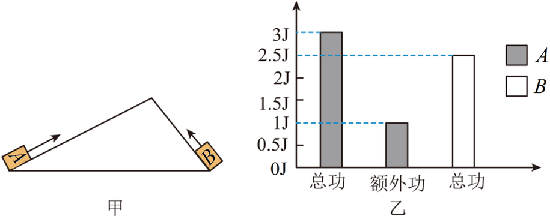

# Physics - 题目 1798

**ID**: bba6a236d8484fe99bdf77827e83757c
**年级**: Grade 9
**难度**: Medium
**题型**: Fill-in-the-blank

## 题目
如图甲，A、B是两个完全相同的物体，分别将A、B两物体沿斜面匀速拉到斜面顶端，对物体做功的情况如图乙所示，则拉物体A的机械效率是（结果保留一位小数），对物体B做的有用功是J；若右边斜面的长度为1m，则物体B所受的摩擦力为N。​​​​​​​‌

## 解答

1. 拉物体A的机械效率 $η=\frac {W{{}_{有A}}}{W{{}_{总A}}}=\frac {3{\rm{J}}-1{\rm{J}}}{3{\rm{J}}}\times 100\%\approx 66.7\%$ ；克服物体重力所做的功为有用功，A、B是两个完全相同的物体，提升的高度相同，有用功也相同，所以对物体B做的有用功 $W{{}_{有B}}=W{{}_{有A}}=W{{}_{总A}}-W{{}_{额A}}=3{\rm{J}}-1{\rm{J}}=2{\rm{J}}$ ；B克服摩擦力所做的额外功 $W{{}_{额B}}=W{{}_{总B}}-W{{}_{有B}}=2.5{\rm{J}}-2{\rm{J}}=0.5{\rm{J}}$ ，则B物体所受的摩擦力 $f{{}_{B}}=\frac {W{{}_{额B}}}{s{{}_{B}}}=\frac {0.5{\rm{J}}}{1{\rm{m}}}=0.5{\rm{N}}$ 。

## 知识点

**中文**:
  - 斜面的机械效率及其计算
  - 滑动摩擦力的大小
  - 有用功、额外功和总功的计算

**English**:
  - Mechanical Efficiency of Inclined Planes and Calculations
  - Magnitude of Sliding Friction
  - Calculation of Useful, Extra, and Total Work

---
