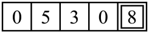
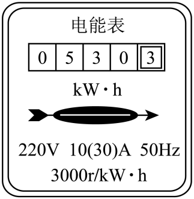

# Physics - 题目 166

**ID**: bc673286a56a44d5a43d29aa71a82976
**年级**: Grade 9
**难度**: Medium
**题型**: Fill-in-the-blank

## 题目
小明断开家中所有用电器后，观察到此时电能表示数如图所示，根据电能表参数分析，此电路中的用电器总功率不能超过W。​​​​​​​‌然后接入“220V  1210W”的电热器单独工作30min，电能表示数变为，则电热器实际工作时两端的电压为V，在30min内电能表转盘转过r。

## 解答

1. 根据电能表参数分析，电能表平时允许通过的最大电流为30A，此电路中的用电器总功率不能超过 $P=UI=220{\rm{V}}\times 30{\rm{A}}=6600{\rm{W}}{\rm ，}$ 标有“220V   1210W”的电热器单独工作30min消耗的电能为 $W=530.8{\rm kW}·{\rm{h}}-530.3{\rm kW}·{\rm{h}}=0.5{\rm kW}·{\rm{h}}{\rm ，}$ 其功率为 $P{{}_{实际}}=\frac {W}{t}=\frac {0.5{\rm kW}·{\rm{h}}}{\frac {30}{60}{\rm{h}}}=1{\rm kW}=1000{\rm{W}}{\rm ，}$ 用电器的电阻为 $R=\frac {U{^{2}}}{P}=\frac {{\left({220{\rm{V}}}\right)^{2}}}{1210{\rm{W}}}=40{\rm{Ω}}{\rm ，}$ 电热器实际工作电压为 $U{{}_{实际}}\sqrt {P{{}_{实际}}R}=\sqrt {1000{\rm{W}}\times 40{\rm{Ω}}}=200{\rm{V}}{\rm ，}$ 在30min内电能表转盘转过 $n=3000r/{\rm kW}·{\rm{h}}\times 0.5{\rm kW}·{\rm{h}}=1500{\rm{r}}$ 。

## 知识点

**中文**:
  - 电功率的计算及应用
  - 电能表的读数及电能的求解

**English**:
  - Calculation and Application of Electric Power
  - Reading Energy Meters and Calculating Energy

---
