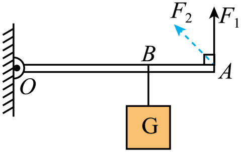

# Physics - 题目 20

**ID**: bcfac612a9074090ae943d84dba2b27b
**年级**: Grade 9
**难度**: Medium
**题型**: Fill-in-the-blank

## 题目
如题图所示，杠杆 $OBA$ 可绕O点在竖直平面内转动， $OB=2BA$ ，在B点悬挂一个 ${\rm{9}}{\rm{N}}$ 的重物G，在A点施加竖直向上的动力F，使杠杆 $OBA$ 水平平衡（杠杆力及摩擦均忽略不计），在A点施加竖直向上的力 $F{{}_{1}}$ 时，该杠杆是（选填“省力”“费力”“等臂”）杠杆，作用在A点的力 $F{{}_{1}}$ 的大小为N，若将作用于A点的力 $F{{}_{1}}$ 变为图中 $F{{}_{2}}$ ，要使杠杆水平平衡， $F{{}_{2}}$ 应$F{{}_{1}}$ （“大于”“小于”“等于”）。​​​​​​​‌

## 解答

1. 在A点施加竖直向上的力 $F{{}_{1}}$ 时，此时动力臂大于阻力臂，则该杠杆是省力杠杆。
2. 由杠杆平衡条件得，作用在A点的力 $F{{}_{1}}$ 的大小为 $F{{}_{1}}=\frac {G\cdot OB}{OA}=\frac {G\cdot OB}{OB+BA}=\frac {G\cdot 2BA}{2BA+BA}=\frac {G}{3}=\frac {9{\rm{N}}}{3}=3{\rm{N}}$ ，若将作用于A点的力 $F{{}_{1}}$ 变为图中 $F{{}_{2}}$ ，要使杠杆水平平衡，此时动力臂变小，阻力与阻力臂不变，由杠杆平衡得，动力变大，即 $F{{}_{2}}$ 应大于 $F{{}_{1}}$ 。

## 知识点

**中文**:
  - 杠杆平衡条件的应用
  - 杠杆的分类

**English**:
  - Application of Lever Equilibrium Conditions
  - Classification of Levers

---
