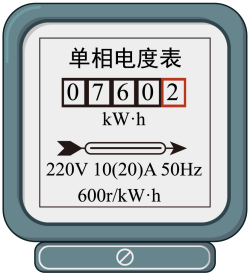

# Physics - 题目 2406

**ID**: c5c34ee17b2c4ecd8747d24e68602a9a
**年级**: Grade 9
**难度**: Medium
**题型**: Fill-in-the-blank

## 题目
李明家中风扇的扇叶粘有些灰尘，这是由于扇叶旋转时发生。​​​​​​​‌李明家的空调铭牌上标有“220V 1000W”，他怀疑空调的额定功率不准确，电路中只接入空调情况下，，6min内观察到他家的电能表的转盘转过了48转，那么只接入空调情况下消耗1kW•h的电能空调工作h。

## 解答

1. 风扇的扇叶粘有些灰尘，这是由于扇叶旋转时发生摩擦起电而带上了电荷，带电体有吸引轻小物体的性质，将灰尘吸附在上面。6min内空调消耗的电能为 $W=\frac {n}{N}=\frac {48{\rm{r}}}{600{\rm{r}}{\rm{/}}\left ({{\rm{k}}{\rm{W}}\cdot {\rm{h}}}\right )}=0.08{\rm{k}}{\rm{W}}\cdot {\rm{h}}$ ，空调的实际功率为 $P=\frac {W}{t}=\frac {0.08{\rm{k}}{\rm{W}}\cdot {\rm{h}}}{6\times \frac {1}{60}{\rm{h}}}=0.8{\rm{k}}{\rm{W}}$ ，只接入空调情况下消耗1kW•h的电能空调工作的时间为 $t^{′}=\frac {W^{′}}{P}=\frac {1{\rm{k}}{\rm{W}}\cdot {\rm{h}}}{0.8{\rm{k}}{\rm{W}}}=1.25{\rm{h}}$ 。

## 知识点

**中文**:
  - 摩擦起电
  - 电能表的读数及电能的求解

**English**:
  - Triboelectricity / Charging by Friction
  - Reading Energy Meters and Calculating Energy

---
