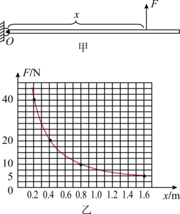

# Physics - 题目 2411

**ID**: c926e24133314793b71854dc329a633c
**年级**: Grade 9
**难度**: Medium
**题型**: Fill-in-the-blank

## 题目
如图甲所示，长1.6m、粗细均匀的金属杆可以绕O点在竖直平面内自由转动，一个“拉力──距离传感器”竖直作用在杆上，并能使杆始终保持水平平衡。​​​​​​​‌该传感器显示其拉力F与作用点到O点距离x的变化关系如图乙中图象所示，可知该金属杆重N。

## 解答

1. 金属杆重心在金属杆的中点上，重力的力臂为 $l{{}_{1}}＝\frac {1}{2}l＝\frac {1}{2}\times 1.6{\rm{m}}＝0.8{\rm{m}}$ ，取图象上的一点F＝20N，l_{2}＝0.4m，根据杠杆的平衡条件：Gl_{1}＝Fl_{2}，所以金属杆的重力 $G=\frac {Fl{{}_{2}}}{l{{}_{1}}}=\frac {20{\rm{N}}\times 0.4{\rm{m}}}{0.8{\rm{m}}}=10{\rm{N}}$ .

## 知识点

**中文**:
  - 杠杆平衡条件的应用

**English**:
  - Application of Lever Equilibrium Conditions

---
