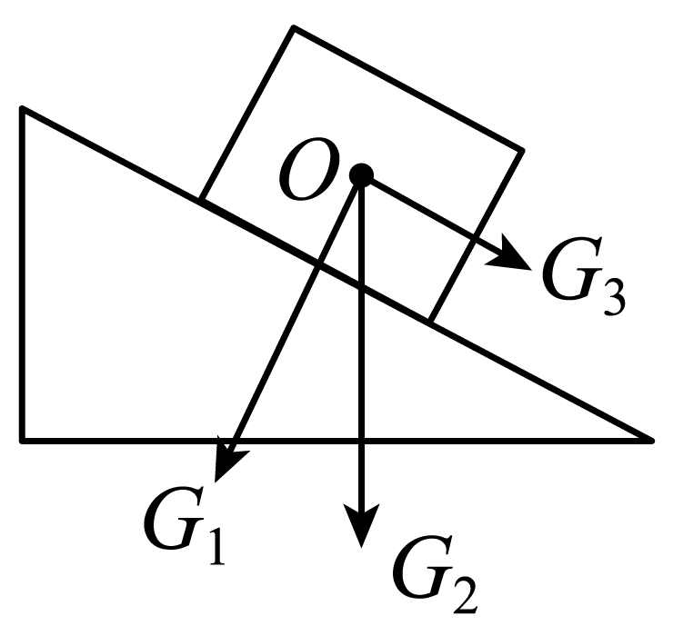
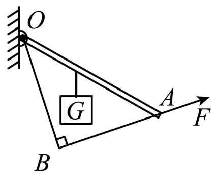

# Physics - 题目 432

**ID**: ca4fa650d155405fbddabef44c52419c
**年级**: Grade 9
**难度**: Medium
**题型**: Fill-in-the-blank

## 题目
（1）一个木块放在斜面上处于静止状态，O点为木块的重心，在图中，（选填“G_{1}”、“G_{2}”或“G_{3}”）是木块所受重力的示意图；（2）如图所示，O点为杠杆OA的支点，拉力F作用在杠杆的A点。​​​​​​​‌图中线段AB与力F的作用线在一条直线上，且AB⊥OB，线段表示拉力F的力臂。（选填“OA”、“OB”或“AB”）

## 解答

1. （1）重力的方向竖直向下，作用点在重心位置，由图可知，G_{2}是木块所受重力的示意图。
2. （2）根据定义，力臂是指支点到力的作用线的垂直距离，O点为杠杆支点，线段AB是拉力F过A点的作用线，OB即为支点到力作用线的垂直距离，表示为拉力的力臂。

## 知识点

**中文**:
  - 杠杆及其五要素
  - 重力的方向

**English**:
  - Levers and their Five Elements
  - Direction of Gravity

---
