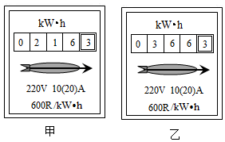

# Physics - 题目 1988

**ID**: cc1b8c0c753f4c6ebba187ddef9371ff
**年级**: Grade 9
**难度**: Medium
**题型**: Fill-in-the-blank

## 题目
如图所示，甲、乙分别为小明家7月底和8月底电能表的读数，则小明家8月份消耗的电能是${\rm{k}}{\rm{W}}\cdot {\rm{h}}$ 。​​​​​​​‌己知 ${\rm{5}}{\rm{m}}{\rm{i}}{\rm{n}}$ 内，小明家电能表铝盘转动100转，则可估算出小明家这段时间内用电器平均功率为${\rm{W}}$ 。

## 解答

1. 由题意可知，8月份消耗的电能为8月底电能表的示数减去7月底电能表的示数，即
2. W=366.3kW•h-216.3kW•h=150kW•h
3. 由电能表表盘信息可知，电能表铝盘转动100转消耗的电能为
4. $W=\frac {100{\rm{r}}}{600{\rm{r}}/{\rm{k}}{\rm{W}}\cdot {\rm{h}}}=\frac {1}{6}{\rm{k}}{\rm{w}}\cdot {\rm{h}}$
5. 用电器工作时间为
6. $t=5{\rm \min }=\frac {1}{12}{\rm{h}}$
7. 故用电器的平均功率为
8. $P=\frac {W}{t}=\frac {\frac {1}{6}{\rm{k}}{\rm{W}}\cdot {\rm{h}}}{\frac {1}{12}{\rm{h}}}=2{\rm{k}}{\rm{W}}=2000{\rm{W}}$

## 知识点

**中文**:
  - 电功率的计算及应用
  - 电能表的读数及电能的求解

**English**:
  - Calculation and Application of Electric Power
  - Reading Energy Meters and Calculating Energy

---
