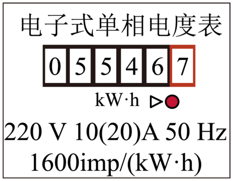

# Physics - 题目 1118

**ID**: cd0a20cf8cee4246b4e84d93593e8db9
**年级**: Grade 9
**难度**: Medium
**题型**: Fill-in-the-blank

## 题目
小华家的家用电能表的信息如图所示，他家所使用的用电器总功率不能超过${\rm{W}}$ ，若只将一台额定功率为 $800{\rm{W}}$ 的电炉单独接在电路中 $30{\rm{m}}{\rm{i}}{\rm{n}}$ ，电能表指示灯应闪烁次。​​​​​​​‌

## 解答

1. 由电能表参数可知，电能表正常工作时的电压为220V，允许通过的最大电流为20A，他家同时使用用电器的最大总功率 $P{{}_{大}}=UI=220\mathrm{V}\times 20\mathrm{A}=4400\mathrm{W}$ 。1600imp/（ $\mathrm{k}\mathrm{W}\cdot \mathrm{h}$ ）表示每消耗 ${\rm 1}\mathrm{k}\mathrm{W}\cdot \mathrm{h}$ 的电能，电能表指示灯闪烁1600次，电炉单独接在电路中30min，即0.5h消耗的电能 $W=Pt=800\times 10{^{-}}{^{3}}\mathrm{k}\mathrm{W}\times 0.5\mathrm{h}=0.4\mathrm{k}\mathrm{W}\cdot \mathrm{h}$ ，电能表指示灯闪烁的次数 $n=1600\mathrm{i}\mathrm{m}\mathrm{p}/（\mathrm{k}\mathrm{W}\cdot \mathrm{h}）\times 0.4\mathrm{k}\mathrm{W}\cdot \mathrm{h}=640\mathrm{i}\mathrm{m}\mathrm{p}$ 。

## 知识点

**中文**:
  - 电能表参数的理解
  - 电能表的读数及电能的求解

**English**:
  - Understanding Energy Meter Parameters
  - Reading Energy Meters and Calculating Energy

---
