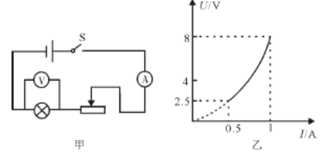

# Physics - 题目 1883

**ID**: ce31c0933efd4428b5d30615482ff576
**年级**: Grade 9
**难度**: Medium
**题型**: Fill-in-the-blank

## 题目
如图所示，电源电压一定，滑动变阻器的滑片从最右端滑到最左瑞时，灯泡L的I-U图像如图乙所示。​​​​​​​‌当通过灯泡的电流为1A时，灯泡正常发光，则灯泡的额定功率为W，电源电压为V，滑动变阻器的最大阻值为Ω。

## 解答

1. [1]由题知，当灯的电流为1A时，灯正常发光，由图象可知，此时灯泡两端的电压为8V，则灯泡的额定功率
2. P= $U{{}_{{\rm{L}}}}I{{}_{{\rm{L}}}}$ =8V×1A=8W
3. [2]由电路图知，滑片在左端时，变阻器连入阻值为0，电路为灯泡的简单电路，此时电路中电阻最小，电流最大为1A，灯泡两端的电压为8V，则电源电压
4. U=U_{L}=8V
5. [3]当滑片位于右端时，灯泡和变阻器的最大阻值串联，电路中电阻最大，电流最小，由图象可知，此时
6. $U^{′}{{{}_{L}}}$  =2.5V
7. $I{{}_{L}}{^{\prime }}$  =0.5A
8. 因串联电路中总电压等于各分电压之和，所以滑动变阻器两端的电压
9. $U{{}_{R}}=U-$  $U^{′}{{{}_{L}}}$  =8V $\mathbf{-}$ 2.5V=5.5V
10. 由Ⅰ= $\frac {U}{R}$ 可得，滑动变阻器的最大阻值
11. $R{{}_{大}}=\frac {U{{}_{R}}}{I^{′}}$ = $\frac {5.5{\rm{V}}}{0.5{\rm{A}}}$ =11Ω

## 知识点

**中文**:
  - 与欧姆定律有关的动态电路计算
  - 电功率的计算及应用
  - 额定电压与额定功率

**English**:
  - Calculations in Dynamic Circuits using Ohm's Law
  - Calculation and Application of Electric Power
  - Rated Voltage and Rated Power

---
