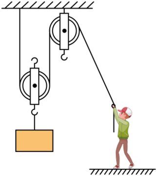

# Physics - 题目 1051

**ID**: cef743952fc649a88a127848154fade2
**年级**: Grade 9
**难度**: Medium
**题型**: Fill-in-the-blank

## 题目
小铭用如图所示滑轮组将重为80N的物体匀速提升3m，动滑轮重为20N，不计绳重和摩擦，则小铭所用拉力F的大小为N，拉力F做的功为J。​​​​​​​‌增大所提升物体的重力，该滑轮组的机械效率将（选填“变大”“变小”或“不变”）。

## 解答

1. 图中所示承担总重的绳子股数n=2，不计绳重和摩擦，拉力 $F=\frac {1}{2}\times \left ({G+G{{}_{0}}}\right )=\frac {1}{2}\times \left ({80{\rm{N}}+20{\rm{N}}}\right )=5{{0}}{\rm{N}}$ ，拉力F移动的距离s=2h=2×3m=6m，拉力F做的功W=Fs=50N×6m=300J，不计绳重和摩擦，滑轮组的机械效率 $η{\rm{=}}\frac {W{{}_{有}}}{W{{}_{总}}}=\frac {W{{}_{有}}}{W{{}_{有}}+W{{}_{额}}}=\frac {Gh}{Gh+G{{}_{动}}h}=\frac {G}{G+G{{}_{动}}}=\frac {1}{1+\frac {G{{}_{动}}}{G}}$ ，动滑轮重不变时，物重增大，机械效率将变大。

## 知识点

**中文**:
  - 有用功、额外功和总功的计算
  - 滑轮组绳子拉力的计算
  - 机械效率的大小比较

**English**:
  - Calculation of Useful, Extra, and Total Work
  - Calculating Rope Tension in Pulley Systems
  - Comparing Mechanical Efficiency

---
