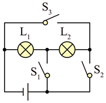

# Physics - 题目 1495

**ID**: cf9a0a775e954c7bb99768ffa5909688
**年级**: Grade 9
**难度**: Medium
**题型**: Fill-in-the-blank

## 题目
如图所示，当同时闭合开关S_{1}和 S_{2}，可以发光的灯是；为了防止电源出现短路，不能同时闭合开关。​​​​​​​‌

## 解答

1. [1]当同时闭合开关S_{1}和 S_{2}，灯泡L_{2}两端被短路，L_{1}可以发光。
2. [2]同时闭合开关S_{2}和S_{3}会导致电源的正负极直接相连，出现电源短路现象。

## 知识点

**中文**:
  - 串、并联电路中短路和断路的分析

**English**:
  - Analysis of Short and Open Circuits

---
