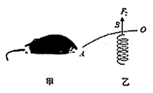

# Physics - 题目 1948

**ID**: d25902e1c5d843eb8c7bb8d2d12261ad
**年级**: Grade 9
**难度**: Medium
**题型**: Fill-in-the-blank

## 题目
如图（甲）所示是一款机械鼠标，它的按键相当于一个杠杆，图（乙）是鼠标左键的简易构造图，AO为按键，O是支点，按键下有一个复位弹簧，复位弹簧对按键的阻力为F2，此杠杆属于（填“省力”或“费力”）杠杆；按下按键时，复位弹簧被压缩，它的弹性势能将（选填“变大”、“不变”或“变小”）。​​​​​​​‌

## 解答

1. [2]弹簧一直处于压缩状态，按下按键时，复位弹簧被压缩程度更大，操作者施加的动力做功，弹簧的弹性势能将增大。

## 知识点

**中文**:
  - 弹性势能的变化问题
  - 杠杆的分类

**English**:
  - Changes in Elastic Potential Energy
  - Classification of Levers

---
