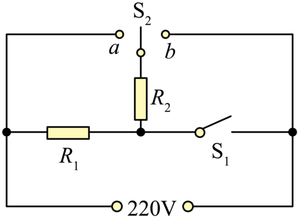

# Physics - 题目 1128

**ID**: d7502eb21d8d4fa0b1b8bc4fdc924076
**年级**: Grade 9
**难度**: Medium
**题型**: Fill-in-the-blank

## 题目
某种型号电热器的等效电路如图所示，它有高、中、低三挡并可手动调节，其额定电压为220V，低温挡、中温挡的额定功率分别为220W和440W，用两定值电阻R_{1}和R_{2}表示两电热丝，单刀双掷开关S_{2}可接a或b。​​​​​​​‌把它接入220V的家庭电路中，高温挡和低温挡功率之比P_{高}︰P_{低}=。

## 解答

1. 当该电热器处于低温挡时，其消耗的总功率最小，电源电压一定，由 $P=\frac {U{^{2}}}{R}$ 可知，总电阻应最大，则两电热丝应串联连接，结合电路图可知，应断开开关S_{1}、同时S_{2}接b；当开关S_{1}闭合、S_{2}接b时，电路为R_{1}的简单电路，此时电热器处于中温挡；由电路图可知，当开关S_{1}闭合、S_{2}接a时，两电热丝并联，电路中的总电阻最小，由 $P=\frac {U{^{2}}}{R}$ 可知，此时电功率最大，电热器处于高温挡。低温挡、中温挡的额定功率分别为220W和440W，因此定值电阻R_{1}的阻值 $R{{}_{1}}=\frac {U{^{2}}}{P{{}_{中温}}}=\frac {(220{\rm{V}}){^{2}}}{440{\rm{W}}}=110{\rm{Ω}}{\rm ，\mathit{R}_{1}}$ 和R_{2}的总电阻 $R{{}_{总}}=\frac {U{^{2}}}{P{{}_{低温}}}=\frac {(220{\rm{V}}){^{2}}}{220{\rm{W}}}=220{\rm{Ω}}$ ，根据串联电路电阻的特点可知，R_{2}的电阻 $R{{}_{2}}=R{{}_{{\rm{总}}}}-R{{}_{1}}=220Ω-110Ω=110Ω$ ，电热器处于高温挡时，两电热丝并联，此时总电阻 $R{{}_{总1}}=\frac {R{{}_{1}}R{{}_{2}}}{R{{}_{1}}+R{{}_{2}}}=\frac {110{\rm{Ω}}\times 110{\rm{Ω}}}{110{\rm{Ω}}+110{\rm{Ω}}}=55{\rm{Ω}}$ ，则高温挡的加热功率 $P{{}_{高温}}=\frac {U{^{2}}}{R{{}_{总1}}}=\frac {(220{\rm{V}}){^{2}}}{55{\rm{Ω}}}=880{\rm{W}}$ ，因此高温挡和低温挡功率之比 $P{{}_{高}}︰P{{}_{低}}=880{\rm{W}}︰{{2}}{{2}}{{0}}{\rm{W}}{\rm{=}}{{4}}︰{{1}}$ 。

## 知识点

**中文**:
  - 串、并联电路中的电功率

**English**:
  - Electric Power in Series/Parallel Circuits

---
