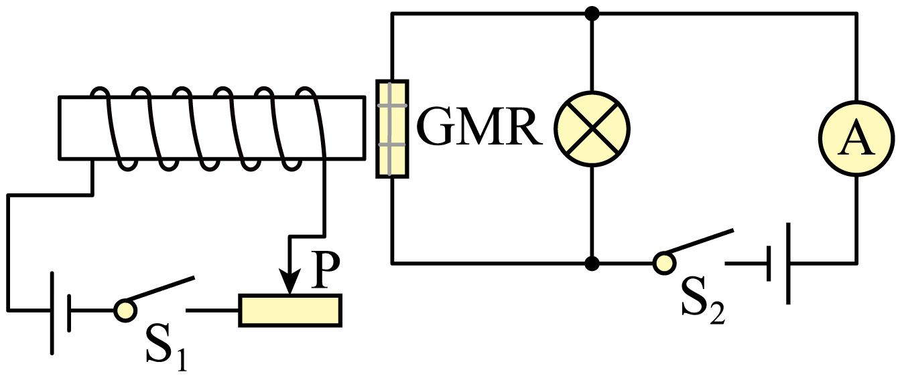

# Physics - 题目 806

**ID**: d8b4650345104ead9a9e17ebf01573f8
**年级**: Grade 9
**难度**: Medium
**题型**: Fill-in-the-blank

## 题目
巨磁电阻（GMR）效应是指某些材料的电阻值随外磁场减小而增大的现象。​​​​​​​‌如图所示，闭合开关S_{1}和S_{2}，通电螺线管的左端是极。若要使电流表示数增大，滑动变阻器应向移动。（填“左”或“右”），此时灯泡的亮度（填“变暗”、“变亮”、“不变”）。

## 解答

1. 根据右手螺旋定则可知，当开关闭合时，螺线管的左端是S极。
2. 由图示可知，当电流表示数变大时，应是右侧电路中的总电阻变小时，也就是巨磁电阻变小，即它所处的磁场增大时，所以应向左移动滑片增大电流使螺线管的磁性增强。
3. 灯泡与巨磁电阻是并联的，所以对灯泡不会造成影响，故灯泡的亮度是不变的。

## 知识点

**中文**:
  - 安培定则及其应用
  - 电磁铁在实际生活中的应用

**English**:
  - Ampere's Rule and Applications
  - Real-life Applications of Electromagnets

---
