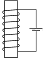
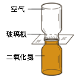

# Physics - 题目 299

**ID**: e08a3e853cab4cb5925c24fecb9796aa
**年级**: Grade 9
**难度**: Medium
**题型**: Fill-in-the-blank

## 题目
(1)如图所示，通电螺线管的上端为极；（选填“N”或“S”）(2)如图所示，两个相同瓶子的瓶口相对，之间用一块玻璃板隔开，上面的瓶中装有空气，下面的瓶中装有密度比空气大的红棕色二氧化氮气体。​​​​​​​‌抽掉玻璃板后，可以看到，两个瓶中的气体会混合在一起，最后颜色变得均匀，这属于现象。

## 解答

1. (1)[1]电流从螺线管的上端流入，下端流出，根据螺线管的线圈绕向，再利用安培定则即可确定螺线管的下端为N极，则上端为S极。
2. (2)[2]抽掉玻璃板后，可看到两种气体逐渐混合在一起，颜色变得均匀，这是分子运动的结果，是扩散现象。

## 知识点

**中文**:
  - 安培定则及其应用
  - 扩散现象

**English**:
  - Ampere's Rule and Applications
  - Diffusion

---
