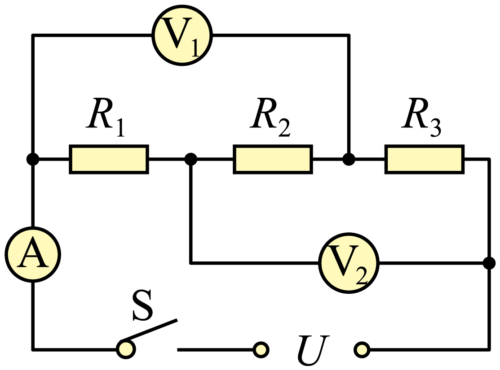

# Physics - 题目 2811

**ID**: e6f6c3f2b123451185879d4af4929d43
**年级**: Grade 9
**难度**: Medium
**题型**: Fill-in-the-blank

## 题目
如图所示电路，电源电压U恒定不变，R_{1}∶R_{2}∶R_{3}＝1∶2∶3，则电压表V_{1}和V_{2}的示数之比为；现将电压表V_{1}换成电流表A_{1}，电压表V_{2}换成电流表A_{2}，则电流表A_{1}和A_{2}的示数之比为。​​​​​​​‌

## 解答

1. 分析电路可知， $R{{}_{1}}$ 、 $R{{}_{2}}$ 、 $R{{}_{3}}$ 串联，电压表 ${\rm{V}}{{}_{1}}$ 测 $R{{}_{1}}$ 、 $R{{}_{2}}$ 的总电压，电压表 ${\rm{V}}{{}_{2}}$ 测 $R{{}_{2}}$ 、 $R{{}_{3}}$ 的总电压， $R{{}_{1}}$ 、 $R{{}_{2}}$ 、 $R{{}_{3}}$ 串联，电流相等，根据 $I=\frac {U}{R}$ 可知电压与电阻成正比，R_{1}∶R_{2}∶R_{3}＝1∶2∶3，则 $R{{}_{1}}$ 、 $R{{}_{2}}$ 、 $R{{}_{3}}$ 电压之比为1∶2∶3，根据串联电压规律，则电压表V_{1}和V_{2}的示数之比为 $3\mathrm{∶}5$ ；现将电压表V_{1}换成电流表A_{1}，电压表V_{2}换成电流表A_{2}，则 $R{{}_{1}}$ 、 $R{{}_{2}}$ 、 $R{{}_{3}}$ 并联，电压相等，根据 $U=IR$ 可知电流与电阻成反比，所以 $R{{}_{1}}$ 、 $R{{}_{2}}$ 、 $R{{}_{3}}$ 的电流之比为 $6\mathrm{∶}3\mathrm{∶}2$ ，此时电流表A_{1}测 $R{{}_{2}}$ 、 $R{{}_{3}}$ 的总电流，电流表A_{2}测 $R{{}_{1}}$ 、 $R{{}_{2}}$ 的总电流，根据并联电流规律，电流表A_{1}和A_{2}的示数之比为 $5\mathrm{∶}9$ 。

## 知识点

**中文**:
  - 串联电路的电压规律
  - 并联电路的电流规律

**English**:
  - Voltage Law in Series Circuits
  - Current Law in Parallel Circuits

---
