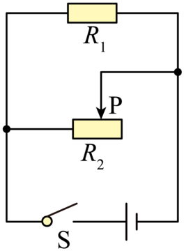

# Physics - 题目 1082

**ID**: f00df150fd9d4249ab7beae3095fe023
**年级**: Grade 9
**难度**: Medium
**题型**: Fill-in-the-blank

## 题目
如图所示的电路中存在一处断路故障，且只发生在电阻R_{1}、R_{2}上。​​​​​​​‌（1）在干路串联一个电流表，闭合开关后，移动滑片P，若说明电阻R_{2}断路；（2）请说明在电路中接入电压表能否判断故障：。

## 解答

1. （1）[1]在干路串联一个电流表，闭合开关，如果R_{2}断路，则电流表测流过R_{1}的电流，此时移动R_{2}的滑片，电流变示数不改变；如果R_{1}断路，电流表测流过R_{2}的电流，移动滑片，电流表的示数会发生改变。
2. （2）[2]在电路中接入电压表，无论R_{1}还是R_{2}断路，电压表均测电源电压，电压表的示数都不会发生变化，所以在电路中接入电压表不能判断故障位置。

## 知识点

**中文**:
  - 电流表、电压表在判断电路故障中的应用

**English**:
  - Using Meters to Diagnose Circuit Faults

---
