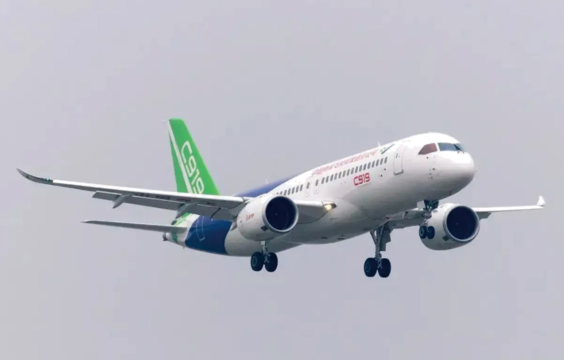

# Physics - 题目 1606

**ID**: f70a2fb859744efebc6b77833d46e054
**年级**: Grade 9
**难度**: Medium
**题型**: Fill-in-the-blank

## 题目
我国自主设计研制的C919大型客机已经完成全部试飞和前期准备，即将于2023年春季正式投入商业营运。​​​​​​​‌（1）飞机能够升空飞行，是因为机翼上方空气的流速比下方空气的流速（选填“大”或“小”），从而产生较大的升力。（2）C919采用北斗导航系统导航与实时数据共享，北斗导航系统发射和接收信号的载体是（选填“超声波”“红外线”“微波”或“激光”）。（3）某次试飞时，C919大飞机10∶45离开虹桥机场，12∶10到达首都机场，全程1178km，则C919大飞机本次飞行的平均速度约为km/h。（结果保留整数）

## 解答

1. （1）由于机翼上表面弯曲，下表面平直，所以机翼上方的流速大于机翼下方的流速，所以机翼上方的压强小于机翼下方的压强，这样就产生了作用在机翼上的向上的升力。
2. （2）北斗导航系统通过微波通信的中继站实现发射和接收信号，微波是电磁波的一种，可以在真空中传播。
3. （3）已知C919大飞机10∶45离开虹桥机场，12∶10到达首都机场，共计飞行时间为
4. $t=t{{}_{2}}-t{{}_{1}}=12∶10-10∶45={{8}}{{5}}{\rm{m}}{\rm{i}}{\rm{n}}\approx {{1}}{{.}}{{4}}{{1}}{{6}}{\rm{h}}$
5. 由 $v=\frac {s}{t}$ 可得，C919大飞机本次飞行的平均速度约为
6. $v=\frac {s}{t}\approx \frac {{{1}}{{1}}{{7}}{{8}}{\rm{k}}{\rm{m}}}{{{1}}{{.}}{{4}}{\rm{h}}}\approx {{8}}{{3}}{{2}}{\rm{k}}{\rm{m}}{\rm{/}}{\rm{h}}$

## 知识点

**中文**:
  - 流体压强与流速的关系
  - 速度公式及其应用

**English**:
  - Relationship between Fluid Pressure and Flow Speed
  - Velocity Formula and Applications

---
