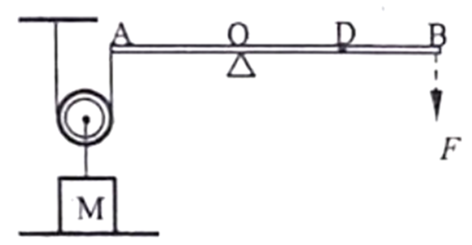

# Physics - 题目 1854

**ID**: 053201a2b36d4858be57da880205069d
**年级**: Grade 9
**难度**: Medium-Hard
**题型**: Calculation

## 题目
如图所示杠杆AB可绕O点在竖直平面内转动， $AO:OB=2:3$ ，D是OB的中点，滑轮重为100N。​​​​​​​‌第一次在B点施加竖直向下的拉力F时，杠杆在水平位置平衡，底面积为 $0.04{\rm{m}}{^{2}}$ 的物体M对水平地面的压强为7500pa；第二次在D点施加同样竖直向下的拉力F时，杠杆在水平位置平衡，物体M对水平地面的压强为15000pa（不计杠杆重、绳重和摩擦）。（1）求第一次施加拉力时，物体M对地面的压力；（2）求拉力F的大小。

## 解答

1. 解：（1）由 $p=\frac {F}{S}$ 可得正方体M对地面的压力F_{压1}=p_{1}S=7500Pa×0.04m^{2}=300N。
2. （2）当F作用B点时，杠杆、动滑轮、正方体M受力如图甲所示
3. 
4. 由杠杆平衡条件可得 $F{{}_{1}}\times AO=F\times OB$ ，因为AO∶OB=2∶3，所以 $F{{}_{1}}=\frac {3}{2}F$ ，对动滑轮分析，由平衡条件得f_{1}+G_{轮}=2F_{1}_{，}则f_{1}=2F_{1}-G_{轮}=3F-100N
5. 力的作用是相互的，所以N_{1}=F_{压1}=300N，则有N_{1}=G-f_{1}=G-(3F-100N)
6. 则200N=G-3F①，当F作用D点时，杠杆、动滑轮、正方体M受力如图乙所示。
7. 
8. 由杠杆平衡条件得F_{2}×AO=F×OD，因为AO∶OB=2∶3，D是OB的中点，所以
9. $F{{}_{2}}=\frac {3}{4}F$ ，对滑轮，由平衡条件得f_{2}+G_{轮}=2F_{2}_{，}则 $f{{}_{2}}=2F{{}_{2}}-G{{}_{轮}}=\frac {3}{2}F-100{\rm{N}}$ ，由 $p=\frac {F}{S}$  可得正方体M对地面的压力，F_{压2}=p_{2}S=15000Pa×0.04m^{2}=600N力的作用是相互的，所以N_{2}=F_{压2}=600N，则有N_{2}+f_{2}=G，则 $500{\rm{N}}=G-\frac {3}{2}F$ ②，联立两式可得：F=200N。
10. 答：（1）第一次施加拉力时，物体M对地面的压力是300N；
11. （2）拉力F的大小是200N。

## 知识点

**中文**:
  - 动滑轮及其工作特点
  - 压力的概念及其计算
  - 压强的计算
  - 杠杆平衡条件的应用

**English**:
  - Movable Pulleys and Operating Characteristics
  - Concept and Calculation of Pressure Force
  - Calculation of Pressure
  - Application of Lever Equilibrium Conditions

---
