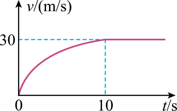

# Physics - 题目 57

**ID**: 07bdeb93b8de402d983ab1c71f3b871f
**年级**: Grade 9
**难度**: Medium-Hard
**题型**: Calculation

## 题目
今年一季度，我国汽车出口量全球第一，电动汽车贡献非常大。​​​​​​​‌如图所示为某型号电动汽车运动的 $v-t$ 图像，它在第10秒时速度达到 $30{\rm{m}}{\rm{/}}{\rm{s}}$ ，然后以 $30{\rm{m}}{\rm{/}}{\rm{s}}$ 的速度做匀速直线运动。已知该车质量为 $1.2{\rm{t}}$ ，以 $30{\rm{m}}{\rm{/}}{\rm{s}}$ 的速度运动时所受阻力为该车重力的0.1倍， $g=10{\rm{N}}{\rm{/}}{\rm{k}}{\rm{g}}$ ，不计机械摩擦。（1）已知物体运动的 $v-t$ 图像与时间轴围成的面积大小等于路程的大小。则在 $0\sim 10{\rm{s}}$ 内，该车通过的路程与 $150{\rm{m}}$ 的大小关系为？（2）该汽车以 $30{\rm{m}}{\rm{/}}{\rm{s}}$ 的速度匀速直线行驶了 $10{\rm{s}}$ ，该过程中加在电动机上的电压为 $500{\rm{V}}$ ，通过的电流为 $100{\rm{A}}$ ，求电动机的效率为多少？（3）求该车电动机的线圈电阻是多少？

## 解答

1. 解：（1）因为物体运动的 $v-t$ 图像与时间轴围成的面积大小等于路程的大小，由下图可知三角形 $OAB$ 面积为 $S{{}_{△}}{{}_{OAB}}\mathrm{=}\frac {1}{2}\mathrm{×}10\mathrm{×}30\mathrm{=}150$ ，该车通过的图形面积大于三角形 $OAB$ 的面积，所以该车通过的路程大于 $150{\rm{m}}$ 。
2. 
3. （2）根据二力平衡知识，汽车匀速直线运动时受到的牵引力 $F{{}_{牵}}=f=0.1G=0.1mg=0.1\times 1.2\times 10{^{3}}{\rm{k}}{\rm{g}}\times 10{\rm{N}}{\rm{/}}{\rm{k}}{\rm{g}}=1.2\times 10{^{3}}{\rm{N}}$ ，根据 $v=\frac {s}{t}$ ，汽车再 $30{\rm{m}}{\rm{/}}{\rm{s}}$ 下 $10{\rm{s}}$ 内行驶的路程 $s=vt=30{\rm{m}}{\rm{/}}{\rm{s}}\times 10{\rm{s}}=300{\rm{m}}$ ，汽车牵引力做功即为有用功 $W{{}_{有}}=W{{}_{牵}}=F{{}_{牵}}s=1.2\times 10{^{3}}{\rm{N}}\times 300{\rm{m}}=3.6\times 10{^{5}}{\rm{J}}$ ，消耗的电能即为总功 $W{{}_{总}}=W{{}_{电}}=UIt=500{\rm{V}}\times 100{\rm{A}}\times 10{\rm{s}}=5\times 10{^{5}}{\rm{J}}$ ，电动机的效率 $η=\frac {W{{}_{有}}}{W{{}_{总}}}=\frac {3.6\times 10{^{5}}{\rm{J}}}{5\times 10{^{5}}{\rm{J}}}=72\%$
4. （3）由题意可知，不计机械摩擦损失，电动机线圈产生的热量即为额外功 $Q=W{{}_{额}}=W{{}_{总}}-W{{}_{有}}=5\times 10{^{5}}{\rm{J}}-3.6\times 10{^{5}}{\rm{J}}=1.4\times 10{^{5}}{\rm{J}}$ ，由焦耳定律 $Q=I{^{2}}Rt$ 得，电动机线圈电阻 $R=\frac {Q}{I{^{2}}t}=\frac {1.4\times 10{^{5}}{\rm{J}}}{{\left({100{\rm{A}}}\right)^{2}}\times 10{\rm{s}}}=1.4Ω$
5. 答：（1）该车通过的路程大于150m；
6. （2）电动机的效率为72%；
7. （3）该车电动机的线圈电阻是1.4Ω。

## 知识点

**中文**:
  - 速度的图像问题
  - 非纯电阻电路的相关计算

**English**:
  - Velocity-Time Graphs
  - Calculations for Non-Pure Resistive Circuits

---
