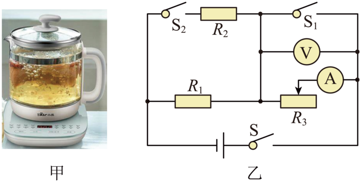

# Physics - 题目 1217

**ID**: 0bb51f17254a402984474d86735558c1
**年级**: Grade 9
**难度**: Medium-Hard
**题型**: Calculation

## 题目
如图甲所示，是一款养生杯，其铭牌如下表所示。​​​​​​​‌它有着高温消毒、中温加热和低挡保温的功能，其等效电路结构如图乙所示。已知：电源电压为36V，R_{1}和R_{2}为发热电阻，R_{3}是规格为“20Ω  5A”的滑动变阻器。S闭合，S_{1}、S_{2}均断开时，电器处于低温挡，移动滑片，可以手动调节低温挡的加热功率；S、S_{1}闭合，通过控制S_{2}的通断，可以使电器处于高温挡或中温挡。产品名称养生杯额定电压36V额定容量30mL额定功率高温档280W中温档180W低温档？（1）养生杯以中温挡正常工作了5min，求发热电阻产生的热量；（2）电阻R_{2}的阻值大小；（3）电压表的量程为“0~24V”，电流表量程为“0~3A”，在不损坏电路元件的前提下，求低温挡手动调节时R_{1}的加热功率范围。

## 解答

1. 解：（1）养生杯以中温挡正常工作了5min，发热电阻产生的热量为
2. $Q=W=P{{}_{中}}t=180{\rm{W}}\times 5\times 60{\rm{s}}=5.4\times 10{^{4}}{\rm{J}}$
3. （2）当S、S_{1}闭合，S_{2}断开时，R_{1}工作，为中温挡；S_{2}闭合时，R_{1}、R_{2}并联，为高温挡。则R_{2}的功率为
4. $P{{}_{2}}=P{{}_{高}}-P{{}_{中}}={{2}}{{8}}{{0}}{\rm{W}}{{-}}{{1}}{{8}}{{0}}{\rm{W}}{\rm{=}}{{1}}{{0}}{{0}}{\rm{W}}$
5. 则电阻R_{2}的阻值大小为
6. $R{{}_{2}}=\frac {U{^{2}}}{P{{}_{2}}}=\frac {(36{\rm{V}}{\rm{)}}{^{2}}}{100{\rm{W}}}=12.96Ω$
7. （3）R_{1}的阻值为
8. $R{{}_{1}}=\frac {U{^{2}}}{P{{}_{中}}}=\frac {(36{\rm{V}}{\rm{)}}{^{2}}}{180{\rm{W}}}=7.2Ω$
9. 当S闭合，S_{1}、S_{2}均断开时，电器处于低温挡，此时R_{1}、R_{3}串联，电压表测量R_{3}两端的电压，电流表测量电路电流。当电压表示数最大为24V时，滑动变阻器连入电路阻值最大，电路电流最小，R_{1}的功率最小。此时R_{1}两端电压为
10. $U{{}_{1}}=U-U{{}_{3}}={{3}}{{6}}{\rm{V}}{{-}}{{2}}{{4}}{\rm{V}}{\rm{=}}{{1}}{{2}}{\rm{V}}$R_{1}的最小功率为
11. $P{{}_{小}}=\frac {U{{}_{1}}{^{2}}}{R{{}_{1}}}=\frac {(12{\rm{V}}){^{2}}}{7.2Ω}=20{\rm{W}}$
12. 由电流表量程及滑动变阻器规格可知，电路的最大电流为3A，则R_{1}的最大功率为
13. $P{{}_{大}}=I{^{2}}R{{}_{1}}=(3{\rm{A}}){^{2}}\times 7.2Ω=64.8{\rm{W}}$
14. 则低温挡手动调节时R_{1}的加热功率范围为20W～64.8W。
15. 答：（1）养生杯以中温挡正常工作了5min，发热电阻产生的热量为5.4×10^{5}J；
16. （2）电阻R_{2}的阻值大小为12.96Ω；
17. （3）在不损坏电路元件的前提下，低温挡手动调节时R_{1}的加热功率范围是20W～64.8W。

## 知识点

**中文**:
  - 焦耳定律的计算公式及其应用
  - 电路的动态分析
  - 电功率的计算及应用

**English**:
  - Formula and Application of Joule's Law
  - Dynamic Circuit Analysis
  - Calculation and Application of Electric Power

---
