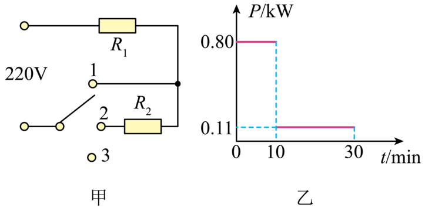

# Physics - 题目 79

**ID**: 0fba2eb7660e45649b13a6d2f4b61c11
**年级**: Grade 9
**难度**: Medium-Hard
**题型**: Calculation

## 题目
某种智能型电饭锅有加热、保温、断电的功能，内部简化电路如图甲所示，开关S可根据设定在“1”、“2”或“3”挡之间自动转换，某次煮饭工作电压为220V，电功率变化情况如图乙所示。​​​​​​​‌求：（1）保温挡的工作电流；（2）加热挡工作10分钟产生的热量；（3）电阻R2的阻值。

## 解答

1. 解：（1）由图乙可知，加热挡功率较大，为
2. P热=0.8kW=800W
3. 保温挡功率较小，为
4. P温=0.11kW=110W
5. 故由P=UI可得，保温挡的工作电流为
6. $I=\frac {P{{}_{温}}}{U}=\frac {110{\rm{W}}}{220{\rm V}}=0.5{\rm{A}}$
7. （2）由W=Pt可得，加热挡工作10分钟产生的热量为
8. Q=W=P热t=800W×10×60s=4.8×105J
9. （3）由 $P=\frac {U{^{2}}}{R}$ 可知，当电源电压不变时，电路的电阻越大，功率越小，由电路图可知，当开关S接“1”时，此时电路中只有电阻R1，阻值较小，故此时电路为加热挡，当开关S接“2”时，电阻R1与R2串联，总电阻较大，故此时电路为保温挡，则有
10. $P{{}_{热}}=\frac {U{^{2}}}{R{{}_{1}}}=\frac {{\left({220{\rm{V}}}\right)^{2}}}{R{{}_{1}}}=800{\rm{W}}$
11. 解得电阻R1的阻值为
12. $R{{}_{1}}=\frac {U{^{2}}}{P{{}_{热}}}=\frac {{\left({220{\rm{V}}}\right)^{2}}}{800{\rm{W}}}=60.5{\rm{Ω}}$
13. $P{{}_{温}}=\frac {U{^{2}}}{R{{}_{总}}}=\frac {{\left({220{\rm{V}}}\right)^{2}}}{R{{}_{1}}+R{{}_{2}}}=110{\rm{W}}$
14. 解得R1和R2串联的总电阻为
15. $R{{}_{总}}=\frac {U{^{2}}}{P{{}_{温}}}=\frac {{\left({220{\rm{V}}}\right)^{2}}}{110{\rm{W}}}=440{\rm{Ω}}$
16. 由串联电路的电阻规律可得，电阻R2的阻值为
17. R2=R总-R1=440Ω-60.5Ω=379.5Ω
18. 答：（1）保温挡的工作电流为0.5A；
19. （2）加热挡工作10分钟产生的热量为4.8×105J；
20. （3）电阻R2的阻值为379.5Ω。

## 知识点

**中文**:
  - 利用电流的热效应工作的用电器
  - 电功与电能的计算
  - 电功率的计算及应用

**English**:
  - Appliances Using Heating Effect
  - Calculation of Electric Work and Energy
  - Calculation and Application of Electric Power

---
