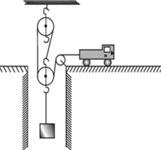

# Physics - 题目 1039

**ID**: 115121a7ea86481c8a1bf8902a9db78c
**年级**: Grade 9
**难度**: Medium-Hard
**题型**: Calculation

## 题目
如图所示，是一辆汽车通过滑轮组将深井中的物体拉至井口的装置图。​​​​​​​‌已知井深12m，物体质量为600千克，汽车重G_{车}=7×10^{4}N，汽车匀速拉绳子时的拉力2200N，汽车受到的阻力为车重的0.1倍。（g=10N/kg）求：(1)将物体从井底拉至井口的过程中，汽车拉绳子做的有用功是多少？(2)滑轮组的机械效率为多少？（保留一位小数）(3)若汽车运动的速度为3m/s，则将物体由井底拉至井口需要多长时间？(4)汽油的热值为4.6×10^{7}J/kg，汽车以3m/s的速度把物体拉到井口时，消耗的汽油为20g，则此汽车发动机的效率为多少？

## 解答

1. 解：(1)将物体从井底拉至井口的过程中，汽车拉绳子做的有用功是
2. $W{{}_{有}}=Gh=mgh=60kg\times 10{\rm{N}}/kg\times 12{\rm{m}}=6000{\rm{N}}\times 12{\rm{m}}=7.2\times 10{^{4}}{\rm{J}}$
3. (2)滑轮组中n=3，拉力做功为
4. $W{{}_{拉}}=Fs=nFh=3\times 2200{\rm{N}}\times 12{\rm{m}}=7.92\times 10{^{4}}{\rm{J}}$
5. 滑轮组的机械效率为
6. $η=\frac {W{{}_{有}}}{W{{}_{拉}}}\times 100\%=\frac {7.2\times 10{^{4}}{\rm{J}}}{7.92\times 10{^{4}}{\rm{J}}}\times 100\%=90.9\%$
7. (3)若汽车运动的速度为3m/s，则将物体由井底拉至井口需要的时间为
8. $t=\frac {s}{v}=\frac {nh}{v}=\frac {3\times 1{\rm{2}}{\rm{m}}}{{\rm{3}}{\rm{m}}{\rm{/}}{\rm{s}}}=1{\rm{2}}{\rm{s}}$
9. (4)消耗的汽油产生的热量为
10. $Q{{}_{放}}=mq{{}_{汽油}}={\rm{0}}{\rm{.}}{\rm{0}}{\rm{2}}{\rm{k}}{\rm{g}}\times {\rm{4}}{\rm{.}}{\rm{6}}\times {\rm{1}}{\rm{0}}{^{{\rm{7}}}}{\rm{J}}{\rm{/}}{\rm{k}}{\rm{g}}={\rm{9}}{\rm{.}}{\rm{2}}\times {\rm{1}}{\rm{0}}{^{5}}{\rm{J}}$
11. 阻力做功为
12. $W{{}_{阻}}=fs=nμG{{}_{车}}h=3\times 0.1\times 7\times 10{^{4}}{\rm{N}}\times 12{\rm{m}}=2.52\times 10{^{5}}{\rm{J}}$
13. 发动机做的总功为
14. $W=W{{}_{拉}}+W{{}_{阻}}=7.92\times 10{^{4}}{\rm{J}}+2.52\times 10{^{5}}{\rm{J}}=3.312\times 10{^{5}}{\rm{J}}$
15. 则此汽车发动机的效率为
16. $η=\frac {W}{Q{{}_{放}}}\times 100\%=\frac {3.312\times 10{^{5}}{\rm{J}}}{9.2\times 10{^{5}}{\rm{J}}}\times 100\%=36\%$
17. 答：(1)将物体从井底拉至井口的过程中，汽车拉绳子做的有用功是 $7.2\times 10{^{4}}{\rm{J}}$ ；
18. (2)滑轮组的机械效率为90.9%；
19. (3)若汽车运动的速度为3m/s，则将物体由井底拉至井口需要12s；
20. (4)此汽车发动机的效率为36%。

## 知识点

**中文**:
  - 有关热机效率的计算
  - 速度公式及其应用
  - 有用功、额外功和总功的计算
  - 滑轮（组）的机械效率及其计算
  - 热值及相关计算

**English**:
  - Calculations of Heat Engine Efficiency
  - Velocity Formula and Applications
  - Calculation of Useful, Extra, and Total Work
  - Mechanical Efficiency of Pulleys and Calculations
  - Calorific Value and Calculations

---
