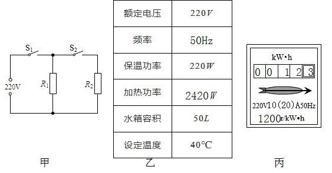

# Physics - 题目 2966

**ID**: 13bba45ff4a7415fa553cc7fe45446d9
**年级**: Grade 9
**难度**: Medium-Hard
**题型**: Calculation

## 题目
图甲所示为某品牌家用热水器的简化电路图，S_{1}是手动开关，置于热水器外部；S_{2}是温控开关，置于热水器内部，当水温低于40℃时自动闭合，达到40℃时自动断开，R_{1}与R_{2}均为用来发热且阻值不变的电热丝，使用时，手动闭合开关S_{1}，电热水器开始工作。​​​​​​​‌图乙为该电热水器部分参数。(1)该热水器正常工作时电热丝R_{1}的阻值是多少？(2)热水器正常加热时，通过R_{2}的电流是多大？(3)假设关闭家中的其它所用用电器，只让该热水器接入电路烧水5min，刚好将水箱中水温升到40℃，观察到家中电能表（如图丙所示）上的转盘转了200r，则此时热水器两端的实际电压多大？

## 解答

1. (1)由图可知，当S_{1}S_{2}均闭合时，R_{1}R_{2}并联接入电路，此时电路总电阻最小，总功率最大，为加热档，当只闭合S_{1}时，仅R_{1}接入电路，此时电路总电阻最大，总功率最小，为保温档。
2. 电热丝R_{1}单独工作时，为保温档，则R_{1}电阻为
3. $R{{}_{1}}=\frac {U{^{2}}}{P{{}_{1}}}=\frac {U{^{2}}}{P{{}_{保温}}}{\rm{=}}\frac {{\left({220{\rm{V}}}\right)^{2}}}{220{\rm{W}}}{\rm{=}}220{\rm{Ω}}$
4. (2)热水器正常加热时，R_{2}的功率为
5. $P{{}_{2}}=P{{}_{加热}}-P{{}_{1}}{\rm{=}}{\rm{2}}{\rm{4}}{\rm{2}}{\rm{0}}{\rm{W}}-{\rm{2}}{\rm{2}}{\rm{0}}{\rm{W}}{\rm{=}}{\rm{2}}{\rm{2}}{\rm{0}}{\rm{0}}{\rm{W}}$
6. 则通过R_{2}的电流为
7. $I{{}_{2}}=\frac {P{{}_{2}}}{U}=\frac {2200{\rm{W}}}{22{\rm{V}}}=10{\rm{A}}$
8. (3)电能表的转盘转过200r，热水器消耗的电能为
9. $W=\frac {n}{N}=\frac {200{\rm{r}}}{1200{{\rm{r}}}/{\left ({{\rm{k}}{\rm{W}}\cdot {\rm{h}}}\right )}}=\frac {1}{6}{\rm{k}}{\rm{W}}\cdot {\rm{h}}{\rm{=}}{\rm{6}}\times {\rm{1}}{\rm{0}}{^{5}}{\rm{J}}$
10. 热水器消耗的实际功率为
11. $P{{}_{实}}=\frac {W}{t}=\frac {6\times 10{^{5}}{\rm{J}}}{5\times 60{\rm{s}}}=2000{\rm{W}}$
12. 由 $P=\frac {U{^{2}}}{R}$ 可得
13. $\frac {P{{}_{实}}}{P{{}_{额}}}{\rm{=}}\frac {\frac {U{{}_{实}^{2}}}{R}}{\frac {U{{}_{额}^{2}}}{R}}{\rm{=}}\frac {U{{}_{实}^{2}}}{U{{}_{额}^{2}}}$
14. 则
15. $\frac {2000{\rm{W}}}{2420{\rm{W}}}{\rm{=}}\frac {U{{}_{实}^{2}}}{{\left({220{\rm{V}}}\right)^{2}}}$
16. 可得
17. $U{{}_{实}}{\rm{=}}200{\rm{V}}$
18. 答：(1)电热丝R_{1}的阻值是220Ω；
19. (2)热水器正常加热时，通过R_{2}的电流是10A；
20. (3)热水器两端的实际电压200V。

## 知识点

**中文**:
  - 电与热综合计算

**English**:
  - Comprehensive Calculation of Electricity and Heat

---
