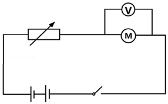

# Physics - 题目 2420

**ID**: 1974ec6b296447d0b56fa9f3e60aa2bd
**年级**: Grade 9
**难度**: Medium-Hard
**题型**: Calculation

## 题目
小金对玩具汽车的电动机很感兴趣，他拆下电动机，测得它的内阻为1.​​​​​​​‌5Ω．为测量电动机工作时的电流，利用身边现有器材，设计了如图所示的电路（符号表示数值可读的变阻器）．已知电源电压为12V，当变阻器的阻值为6Ω时，电压表的读数为3V．计算此时：（1）通过电动机的电流；（2）电动机消耗的电功率．

## 解答

1. （1）∵变阻器两端的电压为U变＝U-U机＝12V-3V＝9V,∴电流I＝ $\frac {U{{}_{变}}}{R{{}_{变}}}＝\frac {9V}{6Ω}$ ＝1.5A,又∵串联电路电流处处相等，∴通过电动机的电流为1.5A;(2)电动机消耗的电功率P＝U机I＝3V $\times $ 1.5A＝4.5W.
2. 点睛：1.根据串联电路的电压特点可求变阻器的电压，由欧姆定律求出变阻器的电流，即为电动机的电流；2.已知电动机的电压和通过电动机的电流，由P=UI可求电动机消耗的电功率．

## 知识点

**中文**:
  - 非纯电阻电路的相关计算

**English**:
  - Calculations for Non-Pure Resistive Circuits

---
