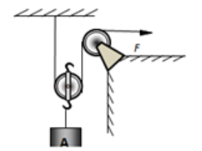

# Physics - 题目 2668

**ID**: 1f541c12cab14a2a9791faf5273eba10
**年级**: Grade 9
**难度**: Medium-Hard
**题型**: Calculation

## 题目
如图是用滑轮组提升重物的示意图，重为80N的物体以0.4m/s的速度匀速上升，滑轮组的机械效率为80%，忽略绳重和轮与轴间的摩擦.求：(1)绳子自由端的拉力大小；(2)动滑轮所受的重力大小；(3)当提升100N的重物时，滑轮组的机械效率。​​​​​​​‌

## 解答

1. 解：(1)由公式可知
2. $η=\frac {W{{}_{有}}}{W{{}_{总}}}=\frac {G}{2F}$
3. 则拉力为
4. $F=\frac {G}{2η}=\frac {80{\rm{N}}}{2\times 0.8}=50{\rm{N}}$
5. (2)由图可知
6. $2F=G{{}_{动}}+G{{}_{物}}$
7. 则动滑轮的重力为
8. $G{{}_{动}}=2F-G{{}_{物}}=2\times 50{\rm{N}}-80{\rm{N}}=20{\rm{N}}$
9. (3)由题意可得
10. $η^{′}=\frac {W{{}_{有}}}{W{{}_{总}}}=\frac {G{{}_{物}^{^{′}}}}{G{{}_{物}^{^{′}}}+G{{}_{动}}}=\frac {100{\rm{N}}}{100{\rm{N}}+20{\rm{N}}}\approx 83.3\%$
11. 答：(1)绳子自由端的拉力为50N；
12. (2)动滑轮的重力为20N；
13. (3)当提升100N的重物时，滑轮组的机械效率约为83.3%。

## 知识点

**中文**:
  - 滑轮组及其工作特点
  - 滑轮组绳子拉力的计算
  - 滑轮（组）的机械效率及其计算

**English**:
  - Pulley Systems and Operating Characteristics
  - Calculating Rope Tension in Pulley Systems
  - Mechanical Efficiency of Pulleys and Calculations

---
